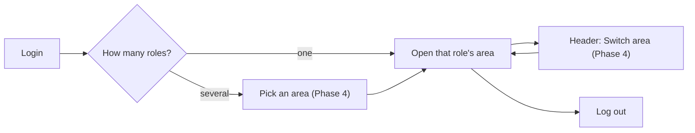
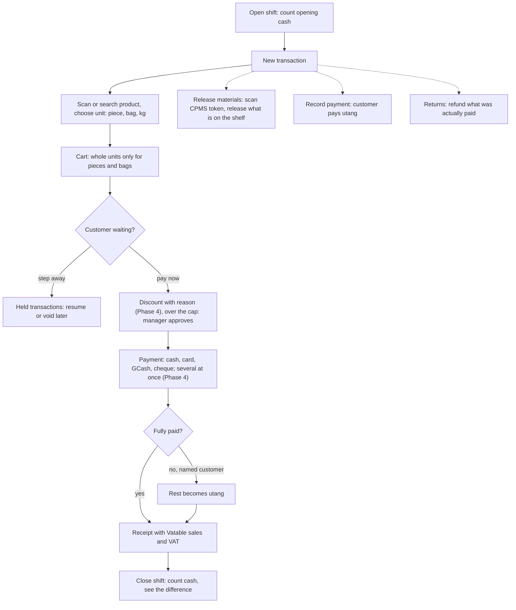
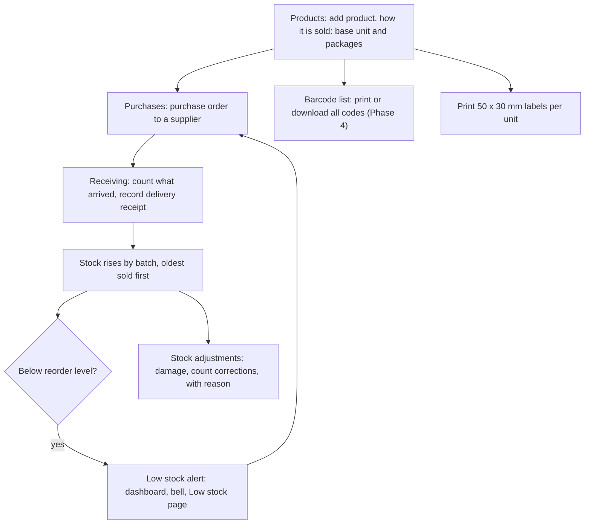
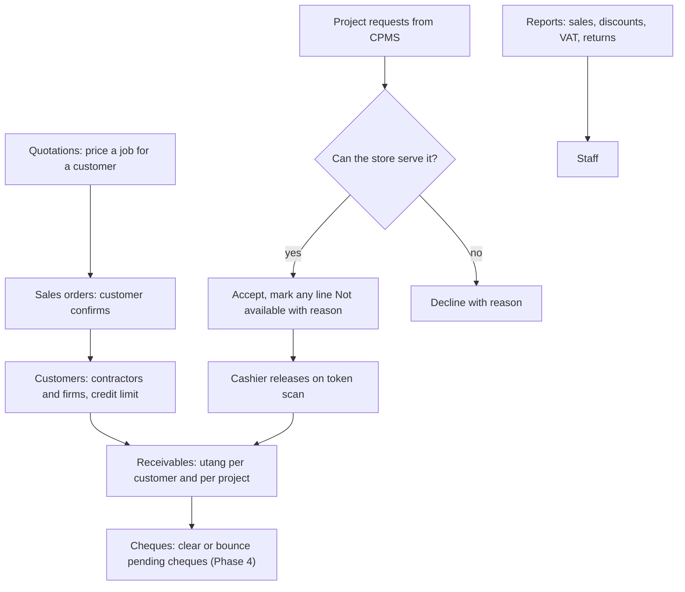
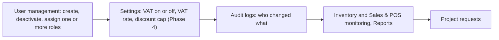
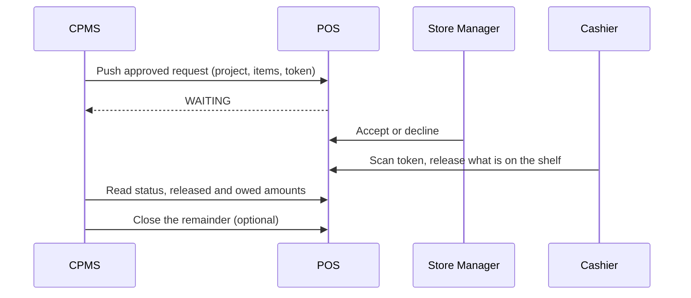

# Role flows — BuildPro POS / Inventory

How each person uses the system, written for the manuscript and the defense. Menus are the real sidebar labels. Phase 4 additions (discount, split and cheque payments, area switcher) are marked **(Phase 4)**; Phase 5 additions are listed at the end.

## Who does what

| Role | Area | Daily job |
| --- | --- | --- |
| Cashier | Point of sale | Sells at the counter, releases CPMS project materials, takes utang payments, handles returns, opens and closes the shift |
| Stock Manager | Inventory | Keeps the catalogue, orders from suppliers, receives deliveries, adjusts stock, answers low-stock alerts |
| Store Manager | Sales | Owns selling beyond the counter (quotations, sales orders), customers and receivables, accepts or declines CPMS project requests, reports, staff. **This is the sales role.** |
| System Administrator | Admin | Users and roles, store settings, audit logs, every report, every area |
| CPMS Service | none (machine) | The CPMS system pushes approved project requests and reads back status and payables |

One person can hold several roles, for example Cashier + Store Manager in a small store. **(Phase 4)** After login they pick an area and can switch from the header at any time.

## Login and areas

Typing another role's address sends the user back to their own area; the server refuses the data anyway.

## Cashier

Menu: New transaction · Transaction history · Release materials · Record payment · Held transactions · Shifts · Returns.

## Stock Manager

Stock only enters through a purchase order and Receiving; Add product never invents opening stock. The reorder level is set per product in the product form.

Menu: Dashboard · Products · Categories · Stock · Stock adjustments · Low stock · Purchases · Suppliers · Receiving · Sales · Returns · Reports · Settings.

## Store Manager (sales)

Menu: Dashboard · Transactions · Quotations · Sales orders · Receivables (Utang and Cheques tabs) · Returns & refunds · Reports · Staff · Project requests. ("Selling", "Customers", "Insights" and "Projects" are section headings, not pages.)

## System Administrator

Guards: the last Admin cannot be removed; a Store Manager cannot grant Admin.

## CPMS (other system)

## Low stock warning

Each product has a reorder level. When stock falls to it, the system raises a Low stock (or Out of stock) alert: shown on the Stock Manager dashboard restock queue, in the bell notifications and on the Low stock page, where it is resolved after reordering.

## Phase 5 additions (planned)

- Stock Manager orders by package ("10 bags at ₱250 per bag"); stock enters in kilograms.
- Store Manager sees supplier bills created at Receiving, pays them (cash, cheque, bank) and watches overdue balances.
- Cashier or Store Manager marks a sale or sales order for delivery with a fee; the Deliveries page moves it Scheduled → Out for delivery → Delivered or Failed.
- Products say where they are stored (Store or Bodega); the receipt and delivery slip say where to pick them up.
