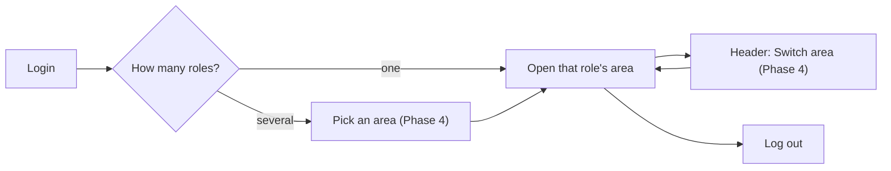
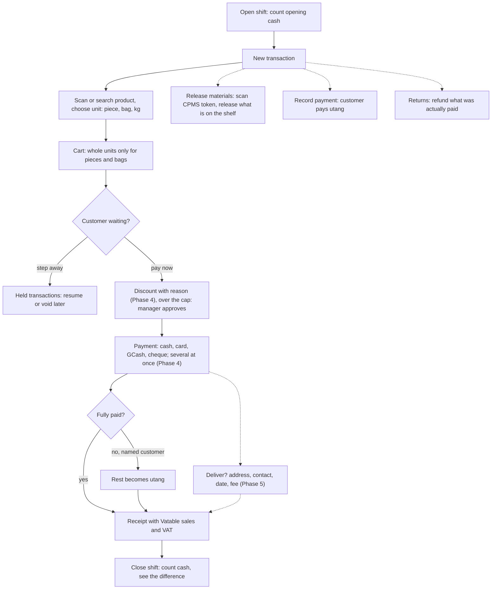
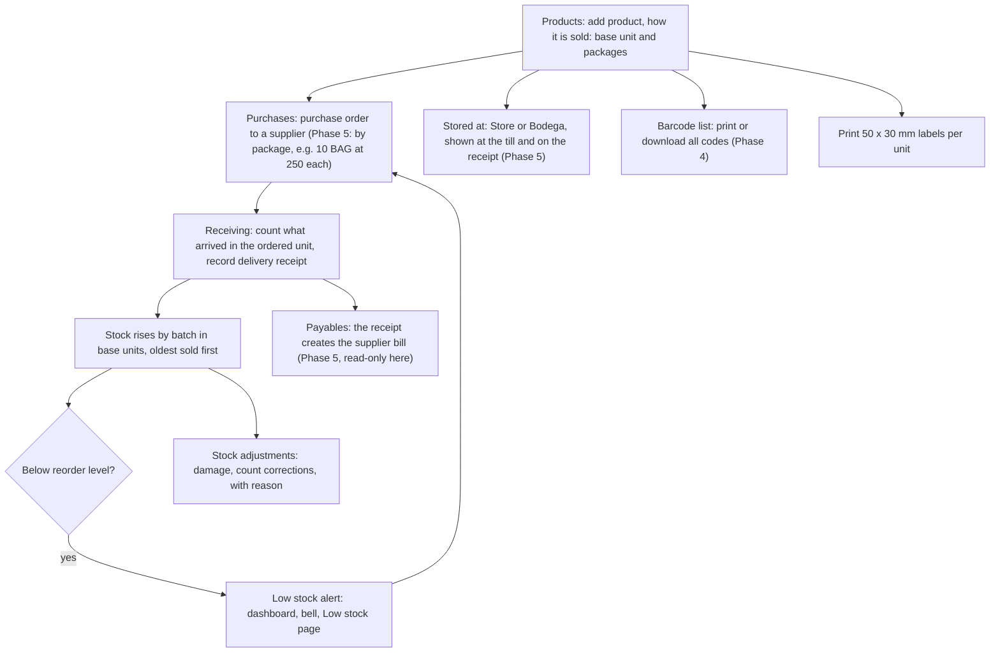
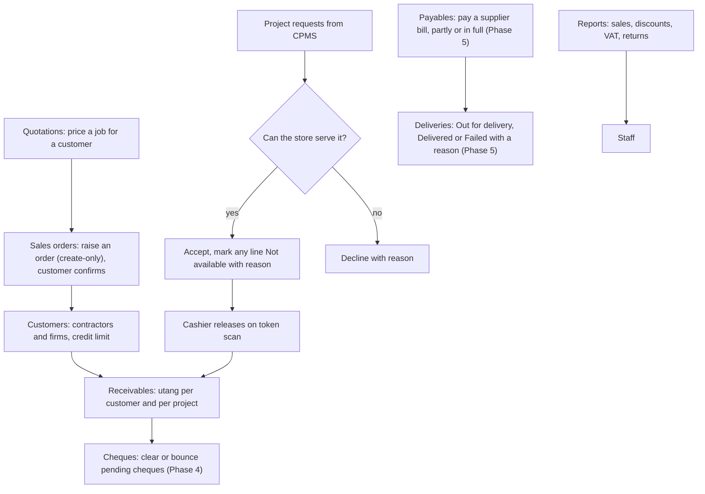
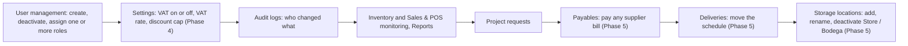
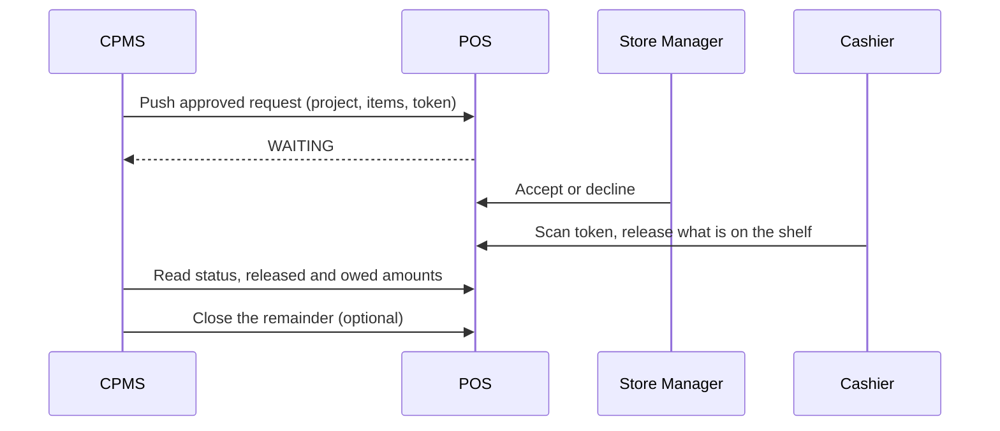

# Role flows — BuildPro POS / Inventory

How each person uses the system, written for the manuscript and the defense. Menus are the real sidebar labels. Phase 4 additions (discount, split and cheque payments, area switcher) are marked **(Phase 4)**; Phase 5 additions (payables, deliveries, stored at) are marked **(Phase 5)** and their exact permissions are in [§ Phase 5](#phase-5-payables-deliveries-and-where-things-are-kept).

Phase 5 ✅ Done — owner-closed 2026-11-12. Editable order-line prices with catalogue defaults are owner-confirmed. BAG validation-text fix is independently approved and freshly widget-verified at 760 / 1.3 (RED→GREEN); this is not fresh browser QA. Fresh full gates are recorded in [plan Task 9](../planning/pos-evolution/phase-5-plan.md). Prepared for authorized local commit (not yet performed), not push. Dev startup/migration/reset and another phase remain unauthorized; printing/scaling and other accepted limits remain unverified.

## Who does what

| Role | Area | Daily job |
| --- | --- | --- |
| Cashier | Point of sale | Sells at the counter, releases CPMS project materials, takes utang payments, handles returns, opens and closes the shift. **(Phase 5)** Can mark a till sale for delivery, but has **no Deliveries page** and cannot move a delivery |
| Stock Manager | Inventory | Keeps the catalogue, orders from suppliers by package, receives deliveries, adjusts stock, answers low-stock alerts. **(Phase 5)** Reads supplier payables (no pay action) and moves deliveries Scheduled → Out for delivery → Delivered/Failed |
| Store Manager | Sales | Owns selling beyond the counter (quotations, sales orders), customers and receivables, accepts or declines CPMS project requests, reports, staff. **This is the sales role.** **(Phase 5)** Pays supplier bills and moves deliveries |
| System Administrator | Admin | Users and roles, store settings, audit logs, every report, every area. **(Phase 5)** Manages the storage-location list, pays supplier bills and moves deliveries |
| CPMS Service | none (machine) | The CPMS system pushes approved project requests and reads back status and payables. Refused everywhere outside `/api/v1/integration/cpms/` (403 `CPMS_SCOPE`), including all Phase 5 resources |

One person can hold several roles, for example Cashier + Store Manager in a small store. **(Phase 4)** After login they pick an area and can switch from the header at any time.

## Login and areas

Typing another role's address sends the user back to their own area; the server refuses the data anyway.

## Cashier

Menu: New transaction · Transaction history · Release materials · Record payment · Held transactions · Shifts · Returns. **(Phase 5)** No Payables and no Deliveries entry: a cashier may take a delivery order at the till, and the server lets them read only their **own** slips through the API, but there is no screen for it.

## Stock Manager

Stock only enters through a purchase order and Receiving; Add product never invents opening stock. The reorder level is set per product in the product form. A purchase order line names its selling unit (“10 BAG at ₱250”): receiving counts in that unit, and stock enters as quantity × factor, so landed cost per base unit is unit cost ÷ factor.

Menu: Dashboard · Products · Categories · Stock · Stock adjustments · Low stock · Purchases · Suppliers · Receiving · Sales · Returns · Reports · Settings · **Payables** (Phase 5, read-only: no pay action in this shell) · **Deliveries** (Phase 5, moves the schedule).

## Store Manager (sales)

Menu: Dashboard · Transactions · Quotations · Sales orders · Receivables (Utang and Cheques tabs) · Returns & refunds · Reports · Staff · Project requests · **Payables** (Phase 5) · **Deliveries** (Phase 5). ("Selling", "Customers", "Insights", "Management" and "Projects" are section headings, not pages. Payables and Deliveries each have a heading and a destination.)

**Sales orders are create-only.** The page has a **New sales order** button that opens a form: a named customer (walk-in is not an option), one or more lines of active catalogue products, each line picked in a selling unit shown as “Product · UNIT (Name)” with the catalogue price pre-filled and editable (owner-confirmed at Phase 5 closure), and an optional Deliver section (address, contact name and phone, scheduled date defaulting to tomorrow, fee at two decimals, zero allowed). A whole unit such as BAG refuses a fraction before anything is sent. Create posts `POST /api/v1/sales-orders/` with no status — the server writes the order as **CONFIRMED** and creates the order and its delivery in one transaction — then the list reloads. That is the whole of it: **no edit, delete, status change or fulfil-to-sale action**, and the View sheet stays read-only. Quotations still have no create form. The button is in the Store Manager (sales) shell; the server lets a Cashier, Store Manager or Admin write an order, and a Stock Manager only reads (POST answers 403).

## System Administrator

Menu: Overview · User management · Inventory · Sales & POS · Reports · Audit logs · Settings · Project requests · **Payables** (Phase 5) · **Deliveries** (Phase 5) · **Storage locations** (Phase 5).

Guards: the last Admin cannot be removed; a Store Manager cannot grant Admin.

## CPMS (other system)

## Low stock warning

Each product has a reorder level. When stock falls to it, the system raises a Low stock (or Out of stock) alert: shown on the Stock Manager dashboard restock queue, in the bell notifications and on the Low stock page, where it is resolved after reordering.

## Phase 5 — payables, deliveries and where things are kept

Three screens, appended to the menus so no earlier entry moved:

| Screen | Where it appears | What you can do |
| --- | --- | --- |
| **Payables** | Admin, Sales and Inventory sidebars | Bills with the supplier, due date, total, balance and an Overdue badge, plus a balance per supplier. **Store Manager and Admin** record a payment (cash, cheque or bank transfer, optional reference, exact cheque number/bank/cheque date, partial allowed). **Stock Manager** sees the same list and the payment history with no pay action. Nobody edits or deletes a bill or a payment — a bill is the record of a delivery and a payment is money that already left |
| **Deliveries** | Admin, Sales and Inventory sidebars | The schedule, filterable by status and date, with a printable delivery slip that lists the items and where each one is picked up. **Store Manager, Admin and Stock Manager** move a delivery: Out for delivery, Delivered, or Failed with a reason. A Cashier has no screen here; the API shows a cashier only the slips they took |
| **Storage locations** | Admin sidebar only | Add, rename and deactivate a place (seeded **Store** and **Bodega**). Admin sees deactivated places so one can be restored; everyone else sees active ones only. No delete: deactivating keeps labelling the products already there and only stops new assignments |

Where things are kept **(Phase 5)** is a label, not a second stock ledger: each product says Store or Bodega, the till line shows a “Bodega” badge, the receipt prints “Pick up at Bodega” and the delivery slip prints the pick-up point per item. Nothing counts or moves stock per location.

Supplier bills **(Phase 5)** are created by Receiving, not typed in: processing a receipt produces one bill for what arrived (package quantity × package cost, less that receipt's share of the PO discount, with the PO's VAT), due after the supplier's terms (0 days by default). A receipt with zero gross value makes no bill, and receipts processed before payables existed have none.

Delivery charges **(Phase 5)**: a till sale can be marked Deliver with an address, contact name and phone, a scheduled date and a fee; the fee prints as a “Delivery charge” line, is VAT-inclusive and is added after the discount, so a discount never reduces it. A sales order carries the same Deliver section through the create-only order form. The fee rules are **owner-confirmed (2026-11-12)**: a zero fee is allowed, the discount cap and a return's net refund exclude the fee, a fee is not refunded, and a sales-order fee lives only on its Delivery row (the order carries no money field).
