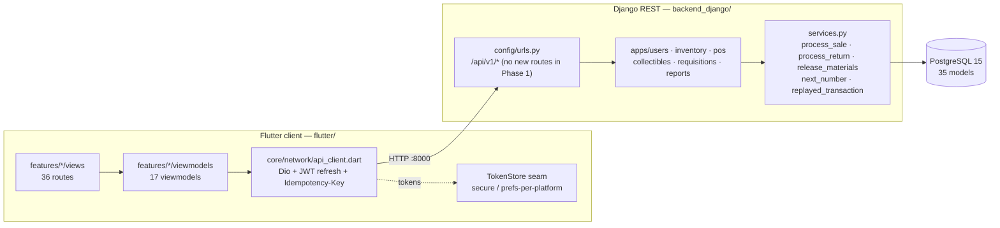

# SYSTEM ATLAS — BuildPro POS / Inventory System

> **Generated:** 2026-10-15 · **Refreshed:** 2026-10-24 (audit-remediation Phase 1 re-verified in source: server price/UOM authority, `Idempotency-Key`, `DocumentCounter`, `GoodsReceiptItem`, credit-limit block) · **Branch:** `feature/backend-integration`
> **Method:** every claim below was verified against source — imports, route tables, model FKs, serializer fields, viewmodel bodies. `README.md`, `PHASE_*.md` and `ENDPOINTS.md` were **not** trusted.
> **Companion:** [`docs/system-atlas.html`](./system-atlas.html) — interactive cockpit (KPIs, filterable Truth Matrix, guided study path).

---

## 1. Architecture

Two processes, one database. A Flutter client talks to a Django REST API; the API owns **all** business logic and persists to PostgreSQL 15. Every client screen reads live API data except static store-info constants on the two settings screens — no `*MockData` file drives any UI (`inventory_mock_data.dart` survives only as first-paint constructor seed, replaced on `load()`). Since Phase 1 the server is the trust boundary: it sets prices from `VariantUOM.default_selling_price`, converts selling qty × `conversion_factor` before FIFO, validates sale payloads (`INVALID_SALE`), blocks over-limit credit, numbers documents from a locked counter, and de-duplicates retried checkouts via `Idempotency-Key`.



**Request lifecycle.** The two oldest paths, plus the Phase 1 checkout contract:

```text
login_page → AuthViewmodel → AuthService → POST /api/v1/auth/login/ → SimpleJWT
products_page → ProductsViewmodel → InventoryViewmodel.load() → GET /products/ + /batches/
checkout → PosTransactionViewmodel (owns attempt key) → POST /transactions/ [Idempotency-Key]
  → process_sale: validate → shift gate → server price → base_qty × CF → FIFO → receipt
```

`InventoryViewmodel` is the product list's **only** home (decisions 11/12).

---

## 2. Data model

Core erDiagram, derived from actual `ForeignKey`/`OneToOneField` declarations. Phase 1 additions marked ★.

```mermaid
erDiagram
  Category       ||--o{ Product : "category"
  Brand          ||--o{ Product : "brand"
  UnitOfMeasure  ||--o{ ProductVariant : "base_uom"
  Product        ||--o{ ProductVariant : "product"
  ProductVariant ||--o{ VariantUOM : "variant"
  UnitOfMeasure  ||--o{ VariantUOM : "uom"
  ProductVariant ||--o{ InventoryBatch : "variant"
  ProductVariant ||--o{ StockAdjustment : "variant"
  ProductVariant ||--o{ SystemAlert : "variant"
  Supplier       ||--o{ PurchaseOrder : "supplier"
  PurchaseOrder  ||--o{ POItem : "po"
  PurchaseOrder  ||--o{ GoodsReceipt : "po"
  GoodsReceipt   ||--o{ GoodsReceiptItem : "★ lines"
  POItem         ||--o{ GoodsReceiptItem : "po_item"
  ProductVariant ||--o{ POItem : "variant"
  GoodsReceipt   ||--o{ InventoryBatch : "receipt"
  Customer       ||--o{ Quotation : "customer"
  Quotation      ||--o{ QuotationItem : "items"
  Quotation      ||--o| SalesOrder : "quotation"
  Customer       ||--o{ SalesOrder : "customer"
  SalesOrder     ||--o{ SalesOrderItem : "items"
  SalesTransaction ||--o{ SalesItemDeduction : "deductions"
  Customer       ||--o{ SalesTransaction : "customer"
  SalesTransaction ||--o{ SalesItem : "items"
  SalesTransaction ||--o{ Payment : "payments"
  SalesTransaction ||--o{ OfficialReceipt : "receipts"
  VariantUOM     ||--o{ SalesItem : "variant_uom"
  Customer       ||--o{ CollectibleLedger : "customer"
  SalesTransaction ||--o{ CollectibleLedger : "transaction"
  CollectibleLedger ||--o{ CollectiblePayment : "collectible"
  Customer       ||--o{ Project : "customer"
  Project        ||--o{ Requisition : "project"
  Requisition    ||--o{ RequisitionItem : "requisition"
  Requisition    ||--o| MaterialToken : "requisition (1:1)"
  ProductVariant ||--o{ RequisitionItem : "variant"
  User           ||--o{ AuditLog : "user"
  User           ||--o{ HeldCart : cashier
  Customer       ||--o{ HeldCart : customer
  HeldCart       ||--o{ HeldCartItem : items
  User           ||--o{ Shift : cashier
  Shift          ||--o{ SalesTransaction : shift
  DocumentCounter : "★ standalone lock row (prefix, day)"
```

**Backbone tables** (35 models, 6 apps — reports has views, no models):

| App | Models | Notes |
| --- | --- | --- |
| `inventory` | 14 | … + ★ `GoodsReceiptItem` (per-receipt lines), `GoodsReceipt.processed_at` lock flag |
| `pos` | 14 | … + ★ `DocumentCounter` (locked numbering); `SalesTransaction.idempotency_key` + `request_hash` (partial unique on cashier+key) |
| `requisitions` | 4 | Project, Requisition, RequisitionItem, MaterialToken |
| `collectibles` | 2 | CollectibleLedger, CollectiblePayment |
| `users` | 1 | AuditLog (`User` extends `AbstractUser`, not `models.Model`) |

`Customer.total_credit_limit` is now nullable: null = unlimited, 0 = no credit (migration `pos.0008`).

---

## 3. Truth Matrix

Legend: 🟢 Live (screen's *primary* data comes from an API response) · 🟡 Partial (row Notes say which part) · 🔴 Mock (hardcoded) · ⚫ Dead (never called)

| Feature / Screen | UI file (`flutter/lib/features/`) | ViewModel / State | Backend endpoint | Status |
| --- | --- | --- | --- | --- |
| Login | `auth/views/login_page.dart` | `auth/viewmodels/auth_viewmodel.dart` | `POST /api/v1/auth/login/` | 🟢 Live |
| Token refresh / logout / me | — (via `ApiClient`) | `auth_viewmodel` | `/auth/refresh/` `/auth/logout/` `/auth/me/` | 🟢 Live |
| Health probe | — | `data/services/health_service.dart` | `GET /api/health/` | 🟢 Live |
| Admin dashboard | `dashboard/views/admin_dashboard.dart` | `dashboard/viewmodels/admin_overview_viewmodel.dart` | `GET /api/v1/reports/sales-summary/` + transactions + inventory | 🟢 Live |
| Inventory dashboard | `dashboard/views/inventory_dashboard.dart` | `inventory/viewmodels/inventory_viewmodel.dart` | products + batches + adjustments | 🟢 Live |
| Inventory stock list | `inventory/views/inventory_stock_page.dart` | `inventory/viewmodels/inventory_viewmodel.dart` | `GET /api/v1/batches/` | 🟢 Live |
| Low stock | `inventory/views/inventory_low_stock_page.dart` | `inventory_viewmodel` | `GET /api/v1/alerts/` | 🟢 Live |
| Stock movements | `inventory/views/inventory_stock_movements_page.dart` | `inventory_viewmodel` | `GET /api/v1/adjustments/` | 🟡 Partial |
| Products | `products/views/products_page.dart` | `products/viewmodels/products_viewmodel.dart` | `GET /api/v1/products/` + `/batches/` | 🟢 Live |
| Categories | `categories/views/categories_page.dart` | `inventory_viewmodel` (mock-seeded; archive local) | — (endpoint exists, uncalled) | 🟡 Partial |
| Suppliers | `suppliers/views/suppliers_page.dart` | `suppliers_purchases_viewmodel` → `SupplierRepository` | `GET /api/v1/suppliers/` | 🟢 Live |
| Purchases / PO | `suppliers/views/purchases_page.dart` | `suppliers_purchases_viewmodel` → `SupplierRepository` | `GET /api/v1/purchase-orders/` | 🟢 Live |
| POS transaction | `pos/views/pos_transaction_page.dart` | `pos/viewmodels/pos_transaction_viewmodel.dart` | `POST /api/v1/transactions/` [+ `Idempotency-Key` ★] | 🟢 Live |
| Sales dashboard | `sales/views/sales_dashboard_page.dart` | `sales/viewmodels/inventory_sales_viewmodel.dart` | `GET /api/v1/transactions/` | 🟢 Live |
| Sales transactions | `sales/views/sales_transactions_page.dart` | `inventory_sales_viewmodel` | `GET /api/v1/transactions/` | 🟢 Live |
| Sales returns | `sales/views/sales_returns_page.dart` | `inventory_sales_viewmodel` | `GET /api/v1/transactions/?source=RETURN` | 🟢 Live |
| Sales reports | `sales/views/sales_reports_page.dart` | wraps shared `ReportsContent` in sales shell | `GET /api/v1/reports/*` | 🟢 Live |
| Quotations | `sales/views/sales_quotations_page.dart` | `sales/viewmodels/sales_module_viewmodel.dart` | `GET /api/v1/quotations/` | 🟢 Live |
| Sales orders | `sales/views/sales_orders_page.dart` | `sales_module_viewmodel` | `GET /api/v1/sales-orders/` | 🟢 Live |
| Receivables / utang | `sales/views/sales_receivables_page.dart` | `sales/viewmodels/sales_receivables_viewmodel.dart` | `GET /api/v1/ledgers/` (+ `/aging/`) | 🟢 Live |
| Inventory sales | `sales/views/inventory_sales_page.dart` | `inventory_sales_viewmodel` | `GET /api/v1/transactions/` | 🟢 Live |
| Inventory returns | `sales/views/inventory_returns_page.dart` | `inventory_sales_viewmodel` | `GET /api/v1/transactions/?source=RETURN` | 🟢 Live |
| Inventory reports | `inventory/views/inventory_reports_page.dart` | static manager-access banner (read-only scope, D-02) | — | 🟢 Live (static) |
| Admin users | `admin/views/admin_user_management_page.dart` | `admin/viewmodels/admin_users_viewmodel.dart` | `GET /api/v1/users/` + `/stats/` + `POST /auth/register/` | 🟢 Live |
| Admin audit logs | `admin/views/audit_logs_page.dart` | `audit_log_repository` → `GET /api/v1/audit-logs/?page=` | `GET /api/v1/audit-logs/` | 🟢 Live |
| Admin requisitions (approve/reject queue) | `admin/views/requisitions_page.dart` | `admin/viewmodels/admin_requisitions_viewmodel.dart` | `GET /api/v1/requisitions/` · `POST /{id}/approve/` · `POST /{id}/reject/` | 🟢 Live |
| Admin reports | `admin/views/reports_page.dart` | `admin/viewmodels/admin_reports_viewmodel.dart` | `GET /api/v1/reports/*` | 🟢 Live |
| Admin monitoring | `admin/views/{sales,inventory}_monitoring_page.dart` | `ReportsRepository` live (`sales-summary` + `inventory-valuation`) | `GET /api/v1/reports/*` | 🟢 Live |
| Admin settings | `admin/views/settings_page.dart` | — (static inline consts, no backend) | — | 🟢 Live (static) |
| Requisition token flow (release counter) | `pos/views/material_release_page.dart` | `pos/viewmodels/material_release_viewmodel.dart` | `/tokens/verify/` `/tokens/release/` | 🟢 Live (`/pos/release`, posNavigation tab 2) |
| Collectibles writes (Record payment) | `sales/views/sales_receivables_page.dart` | `sales_receivables_viewmodel` | `POST /api/v1/ledger-payments/` | 🟢 Live |
| Goods receipts (receiving) | `inventory/views/inventory_receiving_page.dart` | `receiving_viewmodel` | `GET /purchase-orders/` + `POST /goods-receipts/` + `POST /:id/process/` | 🟢 Live |
| Brands / UOMs / variant-UOMs | **no UI** | — | `/brands/` `/uoms/` `/variant-uoms/` | ⚫ Dead |
| Payments / receipts | **no UI** | — | `/payments/` `/receipts/` | ⚫ Dead |
| Project entity | **no UI** | — | `/projects/` | ⚫ Dead |
| POS held transactions | `pos/views/pos_held_transactions_page.dart` | `pos/viewmodels/held_cart_viewmodel.dart` | `GET /held-carts/` + hold/complete/void | 🟢 Live |
| POS shifts + Z-reading | `pos/views/pos_shift_page.dart` | `pos/viewmodels/shift_viewmodel.dart` | `GET /shifts/` + open/close/current | 🟢 Live |

**Score: 32 live · 2 partial · 0 mock · 3 dead (37 rows).** Client calls **34 distinct `/api/v1/` paths** through 15 `ApiClient`-backed services; **36 `GoRoute`s**; **17 viewmodels** (+1 `inventory_mock_data.dart` seed file, not a VM). Phase 1 added no routes and no screens — only backend guarantees + the Flutter idempotency/error-code contract. No mock rows remain.

## 4. Vibe-Debt Hotspots

### Resolved

- Deleted legacy dashboards/reports screens (`7b47db3`, `a037cef`), `AdminMockData` (`02f82de`); POS wiring misconception corrected (screen-scoped VMs are deliberate, decision 11); `pos_dashboard`/`sales_dashboard` orphans removed.

### Duplicate / overlapping files

| Files | Verdict |
| --- | --- |
| `sales/viewmodels/sales_module_viewmodel.dart` vs `sales/viewmodels/inventory_sales_viewmodel.dart` | Split by concern since 6C, one shared `sale_transaction.dart` transport — not two stacks. |
| `core/layout/{admin,inventory,sales}_skeleton_layout.dart` | Three near-clone shells; diff is mostly nav labels. Owned by cleanup plan 04. |
| `inventory/viewmodels/inventory_mock_data.dart` | Constructor seed only (first paint); products/batches replaced on `load()`. Categories stay seeded — matches the 🟡 row. |

- Naming: `dashboard/widget/` + `auth/widget/` stay **singular**; 8 others use `widgets/` (cosmetic).

### Wiring gaps (verified 2026-10-24)

- Uncalled by the client: brands, uoms, receipts, payments, req-items, tokens (list), projects, categories (names arrive nested in products). Called: everything else including suppliers, purchase-orders, audit-logs, `ledgers/aging`, `users/stats`, `variants`, `variant-uoms`.
- `HeldCartService.complete` carries `idempotencyKey` plumbing with **no production caller** (resume sells via `/transactions/`); contract covered by tests only.
- `User`/`AuditLog` APIs still gate on Django `IsAdminUser` (`is_staff`) while the rest of the app gates on the Admin group — Phase 2 decision 04 will switch to `IsAdminRole`.

### Critical business logic (backend)

| Location | What it does | Client consumer? |
| --- | --- | --- |
| `apps/pos/services.py` `process_sale` | Validate → shift gate → server price → `qty × CF` → FIFO → payments → OR → ledger/credit-limit | ✅ POS checkout |
| `apps/pos/services.py` `next_number` + `DocumentCounter` | Locked per-day counter; seeds from max legacy suffix | ✅ sale, return, release |
| `apps/pos/services.py` `replayed_transaction` | Same key+hash → 200 replay; same key+different body → 409; scoped per (cashier, key, endpoint/cart) | ✅ checkout + held-cart complete |
| `apps/pos/services.py` `process_return` | Linked returns capped by negative deduction rows; restock at original batches × CF | ✅ returns pages |
| `apps/inventory/services.py` `process_goods_receipt` | Batches only the receipt's own `GoodsReceiptItem` lines; legacy delta path; `processed_at` lock | ✅ receiving page |
| `apps/inventory/services.py` `apply_stock_adjustment` | Zero-stock positive reopens newest batch; `NO_BATCH_HISTORY` otherwise | ✅ adjustments UI |
| `apps/requisitions/services.py` `approve_requisition` / `release_materials` | Mint token; pre-write `NO_BASE_UOM` guard; release in base units (never re-multiply) | ✅ approve queue / release page |
| `apps/collectibles/models.py` | Utang ledger + payment rollup | ✅ receivables + Record payment |

---

## 5. Read-First Study Path

| # | File | Read | Why it matters |
| --- | --- | --- | --- |
| 1 | `flutter/lib/main.dart` (~90 L) | whole file | Bootstrap + the `MultiProvider` list. Six providers; `Products`/`PosTransaction` VMs are deliberately screen-scoped (decision 11). |
| 2 | `flutter/lib/routes/routes.dart` (~430 L) | `redirectFor` (pure), the role map, the 36 routes | Single source of navigation truth. Roles gate by group; `/admin/reports` + `/admin/requisitions` also admit `sales`. |
| 3 | `flutter/lib/core/network/api_client.dart` (~180 L) | `init()`, interceptors, `post(path, {headers})` | The only network layer: Dio, JWT, refresh-on-401, `Idempotency-Key` passthrough. `init()` is **not idempotent** (`dio` is `late final`). |
| 4 | `flutter/lib/core/network/paged.dart` (~70 L) | whole file | Unwraps the DRF `{count,next,previous,results}` envelope in one place. `hasMore` comes from `next`, not row count. |
| 5 | `flutter/lib/features/inventory/viewmodels/inventory_viewmodel.dart` (~250 L) | `load()`, `isLoading`/`loadError`/`hasLoaded`, `batchesFor`, `stockOnHandFor` | The product list's ONLY home. `load()` mutates in place; on failure keeps the catalogue. |
| 6 | `flutter/lib/data/services/products_service.dart` (~85 L) | whole file | Live fetch through `getList<T>`; body with no `results` must **throw**. |
| 7 | `flutter/lib/core/widgets/async_view.dart` (~95 L) | whole file | Owns loading/error/empty/data for every data screen; builder never runs without data. |
| 8 | `pos_service.dart` + `apps/pos/services.py` `process_sale` | `checkout(idempotencyKey)`, `_failureFor` codes; then `process_sale` + `next_number` + `replayed_transaction` | **The money path (Phase 1).** Client sends `VariantUOM` id + selling qty + attempt key; server validates, prices, converts, locks the counter, de-dupes. Receipt screen renders **server** lines. |
| 9 | `ledger_entry.dart` + `ledger_service.dart` | `paidAmount`, `statusAt`, `fetchLedgers` | Receivables: `paidAmount` derived; server applies payments. |
| 10 | `flutter/lib/data/services/requisition_service.dart` + `models/requisition.dart` | `approve`/`reject`/`verifyToken`/`release`, then the three wire shapes | No `createRequisition`/`submit` — a POS client never files requisitions (CPMS identity). Three shapes for list row / token check / release result; nullable `token`. |
| 11 | `flutter/lib/data/services/user_service.dart` + `features/admin/viewmodels/admin_users_viewmodel.dart` | `fetchUsers`/`fetchUserStats`/`createUser` + `_message`; then `load`/`create`/filters | Strictest error split: 401 vs 403 vs load failure. `getList` parses eagerly. |

---

## 6. Verification Notes

**Verified against source 2026-10-24:** route tables (`routes.dart` 36 `GoRoute`s, role constants), model declarations + FK targets (35 models), `main.dart` provider list, `grep ApiClient` (15 services, zero mock services), `grep /api/v1/` (34 distinct paths), viewmodel bodies (`_attemptKey` lifecycle, `_serverLines`), backend Phase 1 markers (`DocumentCounter`, `GoodsReceiptItem`, `idempotency_key`, `processed_at`, `INVALID_SALE`/`CREDIT_LIMIT_EXCEEDED`/`NO_BASE_UOM`/`RECEIPT_ALREADY_PROCESSED` codes), `temp/audit` dossier left untracked.

**Not verified:** `flutter run` pixels (standing caveat); true-concurrency behavior beyond qa-tester's 10-way live probe; CPMS repo (out of scope).

- Gates: backend **176/176**, flutter **552/552**, `flutter analyze` clean, `manage.py check` clean, `makemigrations --check` clean.
- Known and deliberately unfixed: products toolbar `RenderFlex` overflow at ~1600px widths (`products_toolbar.dart:113`, `products_catalog_overview.dart:156`).
- Deferred minors (ledger `.superpowers/sdd/audit-remediation/progress.md`): release `remaining<=0` race, seed re-forcing Maria's limit, dead duplicate method check in `process_return`, credit-limit TOCTOU (fails closed), pre-`ae514ee` replay hashes now 409.
