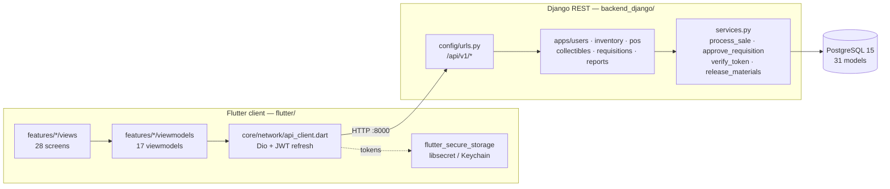
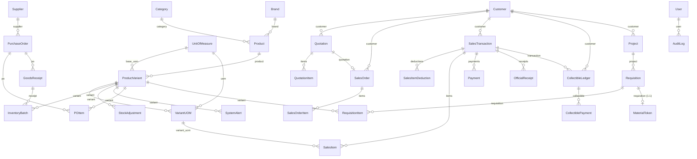

# SYSTEM ATLAS — BuildPro POS / Inventory System

> **Generated:** 2026-10-15 · **Refreshed:** 2026-10-20 (full — Phases 0–6 + dashboard mock-purge re-verified in source; Truth Matrix now 100% live-or-deleted) · **Branch:** `feature/backend-integration` (unpushed, standing decision)
> **Method:** every claim below was verified against source — imports, route tables, model FKs, serializer fields, viewmodel bodies. `README.md`, `PHASE_*.md` and `ENDPOINTS.md` were **not** trusted.
> **Companion:** [`docs/system-atlas.html`](./system-atlas.html) — interactive cockpit (KPIs, filterable Truth Matrix, guided study path).

---

## 1. Architecture

Two processes, one database. A Flutter client talks to a Django REST API; the API owns **all** business logic and persists to PostgreSQL 15. As of the mock-purge (2026-10-20) every client screen reads live API data except the suppliers pages, audit logs, monitoring pages and settings — and no `*MockData` file backs a live screen.



**Request lifecycle.** Every feature below now completes the round trip end to end. The two oldest paths:

```text
login_page     → AuthViewmodel → AuthRepository → AuthService → ApiClient
               → POST /api/v1/auth/login/ → apps.users.views.login_view → SimpleJWT

products_page  → ProductsViewmodel → InventoryViewmodel.load()
               → ProductsRepository → ProductsService → ApiClient
               → GET /api/v1/products/ + GET /api/v1/batches/ → assembleCatalogue → CatalogueItem
```

The products path's *shape*: `InventoryViewmodel` is the product list's **only** home, so loading that one store lit catalogue + inventory + POS in a single move (decisions 11/12). Hardcoded screens left: suppliers, audit logs, monitoring, settings (§3).

**Runtime topology** (`docker-compose.yml`): `buildpro_db` (postgres:15-alpine, host `5435`→`5432`) and `buildpro_backend` (runserver `:8000`, code bind-mounted from `backend_django/`).

---

## 2. Data model

Core erDiagram, derived from actual `ForeignKey`/`OneToOneField` declarations.



**Backbone tables** (31 models, 6 apps — reports has views, no models):

| App | Models | Notes |
| --- | --- | --- |
| `inventory` | 13 | Category, Brand, UnitOfMeasure, Product, ProductVariant, VariantUOM, Supplier, PurchaseOrder, POItem, GoodsReceipt, InventoryBatch, StockAdjustment, SystemAlert |
| `pos` | 10 | Customer, SalesTransaction, SalesItem, **SalesItemDeduction**, Payment, OfficialReceipt, **Quotation, QuotationItem, SalesOrder, SalesOrderItem** |
| `requisitions` | 4 | Project, Requisition, RequisitionItem, MaterialToken |
| `collectibles` | 2 | CollectibleLedger, CollectiblePayment |
| `users` | 2 | User (+ role), AuditLog |

`InventoryBatch` is the FIFO layer — `process_sale` deducts stock across batches in order.

---

## 3. Truth Matrix

Legend: 🟢 Live (screen's *primary* data comes from an API response) · 🟡 Partial (row Notes say which part) · 🔴 Mock (hardcoded) · ⚫ Dead (never called)

| Feature / Screen | UI file (`flutter/lib/features/`) | ViewModel / State | Backend endpoint | Status |
| --- | --- | --- | --- | --- |
| Login | `auth/views/login_page.dart` | `auth/viewmodels/auth_viewmodel.dart` | `POST /api/v1/auth/login/` | 🟢 Live |
| Token refresh / logout / me | — (via `ApiClient`) | `auth_viewmodel` | `/auth/refresh/` `/auth/logout/` `/auth/me/` | 🟢 Live |
| Health probe | — | `data/services/health_service.dart` | `GET /api/health/` | 🟢 Live |
| Admin dashboard | `dashboard/views/admin_dashboard.dart` | `dashboard/viewmodels/admin_overview_viewmodel.dart` | `GET /api/v1/reports/sales-summary/` + transactions + inventory | 🟢 Live |
| Inventory dashboard | `dashboard/views/inventory_dashboard.dart` | `inventory/viewmodels/inventory_viewmodel.dart` | products + batches + adjustments | 🟢 Live |
| Inventory stock list | `inventory/views/inventory_stock_page.dart` | `inventory/viewmodels/inventory_viewmodel.dart` | `GET /api/v1/batches/` | 🟢 Live |
| Low stock | `inventory/views/inventory_low_stock_page.dart` | `inventory_viewmodel` | `GET /api/v1/alerts/` | 🟢 Live |
| Stock movements | `inventory/views/inventory_stock_movements_page.dart` | `inventory_viewmodel` | `GET /api/v1/adjustments/` | 🟡 Partial |
| Products | `products/views/products_page.dart` | `products/viewmodels/products_viewmodel.dart` | `GET /api/v1/products/` + `/batches/` | 🟢 Live |
| Categories | `categories/views/categories_page.dart` | `inventory_viewmodel` (mock-seeded; archive local) | — (endpoint exists, uncalled) | 🟡 Partial |
| Suppliers | `suppliers/views/suppliers_page.dart` | `suppliers_purchases_viewmodel` (hardcoded list, no service) | — (endpoint exists, uncalled) | 🔴 Mock |
| Purchases / PO | `suppliers/views/purchases_page.dart` | `suppliers_purchases_viewmodel` (hardcoded list, no service) | — (endpoint exists, uncalled; receiving screen uses it) | 🔴 Mock |
| POS transaction | `pos/views/pos_transaction_page.dart` | `pos/viewmodels/pos_transaction_viewmodel.dart` | `POST /api/v1/transactions/` | 🟢 Live |
| Sales dashboard | `sales/views/sales_dashboard_page.dart` | `sales/viewmodels/inventory_sales_viewmodel.dart` | `GET /api/v1/transactions/` | 🟢 Live |
| Sales transactions | `sales/views/sales_transactions_page.dart` | `inventory_sales_viewmodel` | `GET /api/v1/transactions/` | 🟢 Live |
| Sales returns | `sales/views/sales_returns_page.dart` | `inventory_sales_viewmodel` | `GET /api/v1/transactions/?source=RETURN` | 🟢 Live |
| Sales reports | ~~`sales/views/sales_reports_page.dart`~~ | consolidated into Admin reports | `GET /api/v1/reports/*` | ⚫ Deleted (`a037cef`) |
| Quotations | `sales/views/sales_quotations_page.dart` | `sales/viewmodels/sales_module_viewmodel.dart` | `GET /api/v1/quotations/` | 🟢 Live |
| Sales orders | `sales/views/sales_orders_page.dart` | `sales_module_viewmodel` | `GET /api/v1/sales-orders/` | 🟢 Live |
| Receivables / utang | `sales/views/sales_receivables_page.dart` | `sales/viewmodels/sales_receivables_viewmodel.dart` | `GET /api/v1/ledgers/` | 🟢 Live |
| Inventory sales | `sales/views/inventory_sales_page.dart` | `inventory_sales_viewmodel` | `GET /api/v1/transactions/` | 🟢 Live |
| Inventory returns | `sales/views/inventory_returns_page.dart` | `inventory_sales_viewmodel` | `GET /api/v1/transactions/?source=RETURN` | 🟢 Live |
| Inventory reports | ~~`reports/views/inventory_reports_page.dart`~~ | consolidated into Admin reports | `GET /api/v1/reports/*` | ⚫ Deleted (`a037cef`) |
| Admin users | `admin/views/admin_user_management_page.dart` | `admin/viewmodels/admin_users_viewmodel.dart` | `GET /api/v1/users/` + `/stats/` + `POST /auth/register/` | 🟢 Live |
| Admin audit logs | `admin/views/audit_logs_page.dart` | `admin_mock_data.dart` | `GET /api/v1/audit-logs/` | 🔴 Mock |
| Admin requisitions (approve/reject queue) | `admin/views/requisitions_page.dart` | `admin/viewmodels/admin_requisitions_viewmodel.dart` | `GET /api/v1/requisitions/` · `POST /{id}/approve/` · `POST /{id}/reject/` | 🟢 Live |
| Admin reports | `admin/views/reports_page.dart` | `admin/viewmodels/admin_reports_viewmodel.dart` | `GET /api/v1/reports/*` | 🟢 Live |
| Admin monitoring | `admin/views/{sales,inventory}_monitoring_page.dart` | `admin_mock_data.dart` | `GET /api/v1/reports/*` | 🔴 Mock |
| Admin settings | `admin/views/settings_page.dart` | — (static) | — | 🔴 Mock |
| Sales dashboard (legacy) | ~~`dashboard/views/sales_dashboard.dart`~~ | — | — | ⚫ Deleted (`7b47db3`) |
| POS dashboard (legacy) | ~~`dashboard/views/pos_dashboard.dart`~~ | — | — | ⚫ Deleted (`7b47db3`) |
| Requisition token flow (release counter) | `pos/views/material_release_page.dart` | `pos/viewmodels/material_release_viewmodel.dart` | `/tokens/verify/` `/tokens/release/` | 🟢 Live — **but unreachable from the UI:** no sidebar entry routes to `/pos/release` (the POS shell's `onTap` is `() {}`); see `planning/cashier-workflow/MAP.md` |
| Collectibles writes (Record payment) | `sales/views/sales_receivables_page.dart` | `sales_receivables_viewmodel` | `POST /api/v1/ledger-payments/` | 🟢 Live |
| Goods receipts (receiving) | `inventory/views/inventory_receiving_page.dart` | `receiving_viewmodel` | `GET /purchase-orders/` + `POST /goods-receipts/` + `POST /:id/process/` | 🟢 Live |
| Brands / UOMs / variant-UOMs | **no UI** | — | `/brands/` `/uoms/` `/variant-uoms/` | ⚫ Dead |
| Payments / receipts | **no UI** | — | `/payments/` `/receipts/` | ⚫ Dead |
| Project entity | **no UI** | — | `/projects/` | ⚫ Dead |

**Score: 23 live · 2 partial · 5 mock · 7 dead (37 rows).** Was 10 · 3 · 17 · 7 before the mock-purge; 9 · 3 · 17 · 8 before the release counter was routed, 8 · 3 · 18 · 8 before Phase 5's approve queue, and 7 · 3 · 20 · 8 before Phase 4 task 7.

Grade history (full story in git log + `docs/sessions/`): Phase 1 lit the catalogue/stock/low-stock together off one `InventoryViewmodel.load()` — the two Partial rows are those whose **own** data stays local (mock-seeded categories; movements render server adjustments but sale/opening rows are local, and the serializer carries a delta with no before/after pair). Phase 2 deleted 190 lines of invented movement history and reads `alerts/` exactly as alerted. Phase 3 took POS 🟡→🟢 (real `VariantUom.id` keys, server receipt, `InsufficientStock`→400, `cashier` read-only). Phase 6 + mock-purge (above) moved every remaining grade; what stays red is honest scope (suppliers, audit logs, monitoring, settings), not debt. `InventoryViewmodel` still seeds its constructor from `InventoryMockData` (first paint never empty; 46 tests pin it) — replaced on load.

## 4. Vibe-Debt Hotspots
- ✅ **RESOLVED 2026-10-17:** underpayment flow reachable (dialog warns instead of refusing). Lesson kept: the dead code survived a phase because nothing tested the **seam** between dialog and `_pay`.

### Duplicate / overlapping files

| Files | Verdict |
| --- | --- |
| ~~`dashboard/views/pos_dashboard.dart`~~ | ⚫ **Deleted 2026-10-20** (`7b47db3`; orphan widgets followed in `f9e7ceb`). |
| ~~`dashboard/views/sales_dashboard.dart`~~ | ⚫ **Deleted 2026-10-20** (`7b47db3`). |
| `sales/viewmodels/sales_module_viewmodel.dart` vs `sales/viewmodels/inventory_sales_viewmodel.dart` | **Split by concern since 6C, shared wire models.** Module VM owns quotations/orders (`sales_module.dart` + `sale_transaction.dart`); inventory VM owns transactions/returns (`sale_transaction.dart` + `sales.dart`). Both import `sale_transaction.dart` — the overlap is one shared transport, not two stacks. The dead `SalesQuotation`/`SalesOrderRow` naming collision was resolved by rename. |
| ~~`reports/views/inventory_reports_page.dart` · `sales/views/sales_reports_page.dart`~~ · `admin/views/reports_page.dart` | **Consolidated 6B.1** (`a037cef`): one four-tab Admin screen; the two legacy screens deleted with routes, nav entries and tests updated. |
| `core/layout/{admin,inventory,sales}_skeleton_layout.dart` | Three near-clone shells; diff is mostly nav labels. Still duplicated — owned by cleanup plan 04, not a phase. |

### Naming inconsistency

- `features/dashboard/widget/` and `features/auth/widget/` are **singular**; the other 8 features use `widgets/`.

### Wiring gaps

- ✅ **RESOLVED 2026-10-16 — this was never a defect.** `PosTransactionViewmodel` and `ProductsViewmodel` are
  still absent from `main.dart`'s `MultiProvider` (6 providers: auth, inventory, suppliers-purchases,
  inventory-sales, sales-module, product-tracking) and that is **correct**. Both are screen-scoped view state
  (decision 11); registering them would share one search box and one half-finished till cart across every
  navigation. `PosTransactionViewmodel` is provided at `pos_transaction_page.dart:35` and `ProductsViewmodel` at
  `products_page.dart`. The old "only 6 of 8 viewmodels are wired" framing assumed absence from `main.dart`
  meant not provided at all; it did not.
- `admin/viewmodels/admin_mock_data.dart` is consumed by **4** screens from one shared mock
  object (audit logs, sales + inventory monitoring, settings — verified 2026-10-20 by grepping
  `features/admin/views/`; was 6 before the mock-purge took overview + users). A count is only a claim until it is counted.

### Disconnected endpoints

- **Wired 2026-10-20** (verified by grepping `lib/` for `/api/v1/` paths): **26 distinct paths** — adjustments, alerts, auth login/logout/me/register, batches, customers, goods-receipts, ledger-payments, ledgers (+ aging), products, purchase-orders, quotations, the four reports, requisitions, sales-orders, tokens verify/release, transactions, users (+ stats). Uncalled by the client: brands, uoms, variants, variant-uoms, suppliers, receipts, payments, req-items, tokens (list), projects, audit-logs, categories (names arrive nested in products).
- Counts refreshed 2026-10-20: **28 `GoRoute`s** in `routes.dart` (was 30; the two legacy report routes were deleted in 6B.1). 6 providers in `main.dart` (auth, inventory, suppliers-purchases, inventory-sales, sales-module, product-tracking); `ProductsViewmodel` and `PosTransactionViewmodel` stay screen-scoped per decision 11.
- **Superseded reference:** `git show 22c7c26 -- flutter/lib/data/services/pos_service.dart` — pre-Phase-1 POS fetch, dropped by a merge; Phase 1 rebuilt it properly (`products_service.dart`, decision-03 `parsePaged`). Read, don't lift (wrong DTO, `availableBaseStock > 0` filter).

### Critical business logic (backend)

`process_sale` gained its first client consumer in Phase 3 and `process_return` in 6C; requisitions
services are exercised by the approve queue and the material-release page. All six backend flows below have
now been observed through the app, not just read.

| Location | What it does | Client consumer? |
| --- | --- | --- |
| `apps/pos/services.py:28` `process_sale` | FIFO stock deduction, payment allocation, OR generation, collectibles posting on underpayment | ✅ **the POS checkout** (Phase 3) |
| `apps/pos/services.py` `process_return` | Linked returns share one cumulative accounting via negative deduction rows; refuses return-of-return and over-draw | ✅ **the returns pages** (6A.4 + 6C) |
| `apps/requisitions/services.py:18` `generate_req_number` | Requisition numbering | ✅ approve queue (Phase 5) |
| `apps/requisitions/services.py:33` `approve_requisition` | DRAFT→APPROVED, mints `MaterialToken` | ✅ approve queue (Phase 5) |
| `apps/requisitions/services.py:50` `verify_token` | Token validation for the POS | ✅ material release page |
| `apps/requisitions/services.py:82` `release_materials` | Token redemption → FIFO deduct → `SalesTransaction` → ledger | ✅ material release page |
| `apps/collectibles/models.py` | Utang ledger + payment rollup | ✅ receivables + Record payment (6C/decision 19) |

---

## 5. Read-First Study Path

Read in this order. Items 4–11 are the files **wired in Phases 0–6 + mock-purge** — read 1–3 first for the layers
they sit on, then the new paths top-down.

| # | File | Read | Why it matters |
| --- | --- | --- | --- |
| 1 | `flutter/lib/main.dart` (~90 L) | whole file | Bootstrap + the `MultiProvider` list. Six providers, and knowing **why** the other two are deliberately not here (decision 11) prevents re-adding them. |
| 2 | `flutter/lib/routes/routes.dart` (~360 L) | `redirectFor` (pure), the role map, the 28 routes | Single source of truth for navigation. `redirectFor` was extracted from the redirect closure so the routing rules are testable without rendering a dashboard. Roles gate by group: admin dashboard is Admin-only; `/admin/reports` and `/admin/requisitions` also admit `sales` (decisions 20); all `/inventory/*` require `inventory`. |
| 3 | `flutter/lib/core/network/api_client.dart` (~175 L) | `init()`, interceptors, `get`/`post`/`getList` | The only network layer: Dio setup, JWT storage, refresh-on-401. Note `init()` is **not idempotent** (`dio` is `late final`). |
| 4 | `flutter/lib/core/network/paged.dart` (~70 L) | whole file | **New (Phase 0).** Unwraps the DRF `{count,next,previous,results}` envelope in exactly one place (decision 03). `hasMore` comes from the `next` link, *not* the row count — the bug a review caught. |
| 5 | `flutter/lib/features/inventory/viewmodels/inventory_viewmodel.dart` (~250 L) | `load()`, `isLoading`/`loadError`/`hasLoaded`, `batchesFor`, `stockOnHandFor` | **New (Phase 1).** The product list's ONLY home, and therefore the hinge of the whole integration: loading it lights up products, inventory and POS at once. `load()` mutates in place (`_products`/`_batches` are `final List`) and on failure keeps the catalogue rather than emptying it. |
| 6 | `flutter/lib/data/services/products_service.dart` (~85 L) | whole file | **New (Phase 1).** The live fetch: both endpoints through `getList<T>`. Its test holds the decision-03 anti-regression — a body with no `results` list must **throw**, not return an empty catalogue. Worked example of the wired screen: `features/products/views/products_page.dart`. |
| 7 | `flutter/lib/core/widgets/async_view.dart` (~95 L) | whole file | **New (Phase 0).** Owns loading/error/empty/data for every data screen (decision 07); the precedence is baked in so the builder never runs without data. |
| 8 | `pos_service.dart` + `apps/pos/services.py:28` `process_sale` | payload/result types, `checkout`; then `process_sale` L28-111 | **Phase 3 — the money path.** `variant_id` is a `VariantUom` id, no `cashier` key (server assigns), cart clears only on 201. Server: one `transaction.atomic()` — FIFO, payments, OR, ledger. Observed live: 201 moved stock 95→93; short sale → 400 `INSUFFICIENT_STOCK`. |
| 9 | `ledger_entry.dart` + `ledger_service.dart` | `paidAmount`, `statusAt`, `fetchLedgers` | **Phase 4 T7 — receivables.** `paidAmount` is derived (`original − balance`); the server applies payments. `statusAt` compares at day granularity to match `due_date < today()`. Pagination followed: stopping at the 50th debt hides money. |
| 10 | `flutter/lib/data/services/requisition_service.dart` (~150 L) **+** `.../models/requisition.dart` (~200 L) | `approve`/`reject`/`verifyToken`/`release`, then the three wire shapes | **New (Phase 5 T1, decision 09).** Note what is ABSENT: no `createRequisition` and no `submit`. That is the decision made structural — a service without them cannot grow a button needing a Site Foreman, which is a CPMS identity that never logs into POS. Three DIFFERENT shapes (`Requisition`, `TokenVerification`, `ReleaseResult`) because the list row, the token check and the release result answer different questions. `token` is nullable because DRAFT/SUBMITTED rows have no token — verified live, and a regular DRF `Field` renders `None` where a `ReadOnlyField` **skips the key**. |
| 11 | `flutter/lib/data/services/user_service.dart` (~150 L) **+** `features/admin/viewmodels/admin_users_viewmodel.dart` (~180 L) | `fetchUsers`/`fetchUserStats`/`createUser` + `_message`; then `load`/`create`/filters | **New (mock-purge).** The newest stack and the strictest error split: 401 session-expired vs 403 permission-denied vs load failure. `getList` parses rows **eagerly**, so the malformed-row guard sits on the outer catch — an inner try around `items.toList()` misses (proven by a RED test failing as no-throw). Create errors live in `createError`, never in the page banner. |

---

## 6. Verification Notes

**Verified against source:** route tables (`config/urls.py`, `apps/*/urls.py`), model declarations + `ForeignKey` targets, `main.dart` provider list, `grep -rln ApiClient flutter/lib`, viewmodel bodies, `routes.dart` imports vs on-disk files.

**Not verified:**
- Gate 2026-10-20: `flutter analyze` clean, flutter **395/395**, backend **89/89**, `manage.py check` clean.
  `flutter/test/widget_test.dart` is tracked and green. (Was 291/46 after Phase 3; Phase 1 ended at 146.)
- The backend **was** re-scanned in this refresh: Phase 6 added `Quotation/QuotationItem`,
  `SalesOrder/SalesOrderItem` and `SalesItemDeduction` (erDiagram + backbone table updated above), and every
  service in the business-logic table now has a client consumer observed through the app.
- ✅ **Corrected 2026-10-20 — 6D ran the app live.** `flutter run -d web-server` against the live backend:
  login as cashier/manager, till cart add, all sales screens, receiving flow, hash-navigated verification
  (auth is lost on full navigation, so pages were reached via location hash). Found and fixed two defects:
  `main.dart` awaiting desktop-only `window_manager` hung web boot (now `kIsWeb`-guarded), and the till never
  triggered an inventory load (now loads on open with banner + retry). #21 underpayment verified live:
  walk-in short-pay → 400 `WALK_IN_CANNOT_OWE`; Maria Santos short-pay → 201 + OPEN ledger.
- The three viewmodels not using an API layer were checked by import/usage grep, not by runtime tracing.
- Known and deliberately unfixed: the products toolbar overflows (`A RenderFlex overflowed by 9.7 pixels`) from
  `products/widgets/products_toolbar.dart:113` and `products_catalog_overview.dart:156`, visible at ~1600px
  widths. Found while testing Phase 1; UI work outside that phase.
