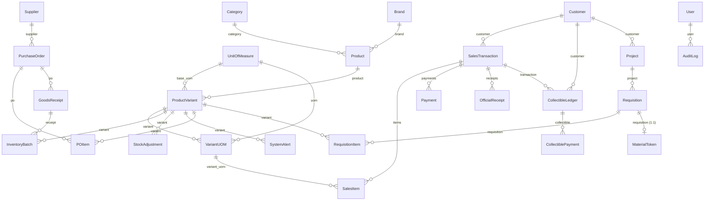

# SYSTEM ATLAS — BuildPro POS / Inventory System

> **Generated:** 2026-10-15 · **Refreshed:** 2026-10-16 (incremental — only the Flutter modules touched by the staged model swap, Phase 0 and Phase 1 were re-verified; the backend apps were **not** re-scanned) · **Branch:** `feature/backend-integration`
> **Method:** every claim below was verified against source — imports, route tables, model FKs, serializer fields, viewmodel bodies. `README.md`, `PHASE_*.md` and `ENDPOINTS.md` were **not** trusted.
> **Companion:** [`docs/system-atlas.html`](./system-atlas.html) — interactive cockpit (KPIs, filterable Truth Matrix, guided study path).

---

## 1. Architecture

Two processes, one database. A Flutter client talks to a Django REST API; the API owns **all** business logic and persists to PostgreSQL 15. The client currently exercises only a sliver of it.


**Request lifecycle.** Two features now complete the round trip end to end — auth, and (since Phase 1) the
products catalogue:

```text
login_page     → AuthViewmodel → AuthRepository → AuthService → ApiClient
               → POST /api/v1/auth/login/ → apps.users.views.login_view → SimpleJWT

products_page  → ProductsViewmodel → InventoryViewmodel.load()
               → ProductsRepository → ProductsService → ApiClient
               → GET /api/v1/products/ + GET /api/v1/batches/ → assembleCatalogue → CatalogueItem
```

The products path is worth noting for its *shape*: `InventoryViewmodel` is the product list's **only** home, so
loading that one store made the catalogue, the inventory screens and the POS catalogue read live data in a
single move. Decision 11 (`ProductsViewmodel` reads the store) and decision 12 (Phase 1 loads that store) were
chosen for exactly that reason. Every remaining feature still renders a hardcoded list. See the Truth Matrix in §3.

**Runtime topology** (`docker-compose.yml`): `buildpro_db` (postgres:15-alpine, host `5435`→`5432`) and `buildpro_backend` (runserver `:8000`, code bind-mounted from `backend_django/`).

---

## 2. Data model

Core erDiagram, derived from actual `ForeignKey`/`OneToOneField` declarations.



**Backbone tables** (25 models, 5 apps):

| App | Models | Notes |
| --- | --- | --- |
| `inventory` | 14 | Category, Brand, UnitOfMeasure, Product, ProductVariant, VariantUOM, Supplier, PurchaseOrder, POItem, GoodsReceipt, InventoryBatch, StockAdjustment, SystemAlert |
| `pos` | 5 | Customer, SalesTransaction, SalesItem, Payment, OfficialReceipt |
| `requisitions` | 4 | Project, Requisition, RequisitionItem, MaterialToken |
| `collectibles` | 2 | CollectibleLedger, CollectiblePayment |
| `users` | 2 | User (+ role), AuditLog |

`InventoryBatch` is the FIFO layer — `process_sale` deducts stock across batches in order.

---

## 3. Truth Matrix

Legend: 🟢 Live (real API) · 🟡 Partial · 🔴 Mock (hardcoded) · ⚫ Dead (never called)

| Feature / Screen | UI file (`flutter/lib/features/`) | ViewModel / State | Backend endpoint | Status |
| --- | --- | --- | --- | --- |
| Login | `auth/views/login_page.dart` | `auth/viewmodels/auth_viewmodel.dart` | `POST /api/v1/auth/login/` | 🟢 Live |
| Token refresh / logout / me | — (via `ApiClient`) | `auth_viewmodel` | `/auth/refresh/` `/auth/logout/` `/auth/me/` | 🟢 Live |
| Health probe | — | `data/services/health_service.dart` | `GET /api/health/` | 🟢 Live |
| Admin dashboard | `dashboard/views/admin_dashboard.dart` | `dashboard/viewmodels/admin_overview_viewmodel.dart` | `GET /api/v1/reports/sales-summary/` + transactions + inventory | 🟢 Live |
| Inventory dashboard | `dashboard/views/inventory_dashboard.dart` | `inventory/viewmodels/inventory_viewmodel.dart` | products + batches + adjustments | 🟢 Live |
| Inventory stock list | `inventory/views/inventory_stock_page.dart` | `inventory/viewmodels/inventory_viewmodel.dart` | `GET /api/v1/batches/` | 🟢 Live |
| Low stock | `inventory/views/inventory_low_stock_page.dart` | `inventory_viewmodel` | `GET /api/v1/alerts/` | 🟢 Live |
| Stock movements | `inventory/views/inventory_stock_movements_page.dart` | `inventory_viewmodel` | `GET /api/v1/adjustments/` | 🟡 Partial |
| Products | `products/views/products_page.dart` | `products/viewmodels/products_viewmodel.dart` | `GET /api/v1/products/` + `/batches/` | 🟢 Live |
| Categories | `categories/views/categories_page.dart` | `inventory_viewmodel` (was recorded as local state — wrong) | `GET /api/v1/categories/` | 🟡 Partial |
| Suppliers | `suppliers/views/suppliers_page.dart` | `suppliers_purchases_viewmodel` | `GET /api/v1/suppliers/` | 🔴 Mock |
| Purchases / PO | `suppliers/views/purchases_page.dart` | `suppliers_purchases_viewmodel` | `GET /api/v1/purchase-orders/` | 🔴 Mock |
| POS transaction | `pos/views/pos_transaction_page.dart` | `pos/viewmodels/pos_transaction_viewmodel.dart` | `POST /api/v1/transactions/` | 🟢 Live |
| Sales dashboard | `sales/views/sales_dashboard_page.dart` | `sales/viewmodels/inventory_sales_viewmodel.dart` | `GET /api/v1/transactions/` | 🟢 Live |
| Sales transactions | `sales/views/sales_transactions_page.dart` | `inventory_sales_viewmodel` | `GET /api/v1/transactions/` | 🟢 Live |
| Sales returns | `sales/views/sales_returns_page.dart` | `inventory_sales_viewmodel` | `GET /api/v1/transactions/?source=RETURN` | 🟢 Live |
| Sales reports | ~~`sales/views/sales_reports_page.dart`~~ | consolidated into Admin reports | `GET /api/v1/reports/*` | ⚫ Deleted (`a037cef`) |
| Quotations | `sales/views/sales_quotations_page.dart` | `sales/viewmodels/sales_module_viewmodel.dart` | `GET /api/v1/quotations/` | 🟢 Live |
| Sales orders | `sales/views/sales_orders_page.dart` | `sales_module_viewmodel` | `GET /api/v1/sales-orders/` | 🟢 Live |
| Receivables / utang | `sales/views/sales_receivables_page.dart` | `sales/viewmodels/sales_receivables_viewmodel.dart` | `GET /api/v1/ledgers/` | 🟢 Live |
| Inventory sales | `sales/views/inventory_sales_page.dart` | `inventory_sales_viewmodel` | `GET /api/v1/transactions/` | 🟢 Live |
| Inventory returns | `sales/views/inventory_returns_page.dart` | `inventory_sales_viewmodel` | `GET /api/v1/transactions/?source=RETURN` | 🟢 Live |
| Inventory reports | ~~`reports/views/inventory_reports_page.dart`~~ | consolidated into Admin reports | `GET /api/v1/reports/*` | ⚫ Deleted (`a037cef`) |
| Admin users | `admin/views/admin_user_management_page.dart` | `admin/viewmodels/admin_users_viewmodel.dart` | `GET /api/v1/users/` + `/stats/` + `POST /auth/register/` | 🟢 Live |
| Admin audit logs | `admin/views/audit_logs_page.dart` | `admin_mock_data.dart` | `GET /api/v1/audit-logs/` | 🔴 Mock |
| Admin requisitions (approve/reject queue) | `admin/views/requisitions_page.dart` | `admin/viewmodels/admin_requisitions_viewmodel.dart` | `GET /api/v1/requisitions/` · `POST /{id}/approve/` · `POST /{id}/reject/` | 🟢 Live |
| Admin reports | `admin/views/reports_page.dart` | `admin/viewmodels/admin_reports_viewmodel.dart` | `GET /api/v1/reports/*` | 🟢 Live |
| Admin monitoring | `admin/views/{sales,inventory}_monitoring_page.dart` | `admin_mock_data.dart` | `GET /api/v1/reports/*` | 🔴 Mock |
| Admin settings | `admin/views/settings_page.dart` | — (static) | — | 🔴 Mock |
| Sales dashboard (legacy) | ~~`dashboard/views/sales_dashboard.dart`~~ | — | — | ⚫ Deleted (`7b47db3`) |
| POS dashboard (legacy) | `dashboard/views/pos_dashboard.dart` | `dashboard_mock_data.dart` | — | ⚫ Orphaned |
| Requisition token flow (release counter) | `pos/views/material_release_page.dart` | `pos/viewmodels/material_release_viewmodel.dart` | `/tokens/verify/` `/tokens/release/` | 🟢 Live |
| Collectibles CRUD (writes) | — (no client screen) | — | `POST/PUT/DELETE ledgers/`, `ledger-payments/` | ⚫ Dead |
| Goods receipts | **no UI** | — | `/goods-receipts/` | ⚫ Dead |
| Brands / UOMs / variant-UOMs | **no UI** | — | `/brands/` `/uoms/` `/variant-uoms/` | ⚫ Dead |
| Payments / receipts | **no UI** | — | `/payments/` `/receipts/` | ⚫ Dead |
| Project entity | **no UI** | — | `/projects/` | ⚫ Dead |

**Score: 10 live · 3 partial · 17 mock · 7 dead (37 rows).** Was 9 · 3 · 17 · 8 before the release counter was routed, 8 · 3 · 18 · 8 before Phase 5's approve queue, and 7 · 3 · 20 · 8 before Phase 4 task 7.

Grading rule, so these are not vibes: 🟢 Live = the screen's *primary* data comes from an API response;
🟡 Partial = some of what it renders is live and the row's Notes say which; ⚫ Dead = never called.

Why they moved: `InventoryViewmodel` is the product list's only home, so **loading it once** (Phase 1) turned
the catalogue, the stock list and the low-stock list live together. The two Partial rows are those whose
**own** data is still local — category names (`InventoryMockData.categories`) and the movements table, which
now renders the **server's** adjustments but leaves Previous/New/Reference blank because
`StockAdjustmentSerializer` carries a delta with no before/after pair, and whose sale and opening-stock rows are
still recorded locally (Phase 2; see `decision 13`). `/brands/`, `/uoms/` and `/variant-uoms/` stay dead as
standalone endpoints: selling units now arrive nested inside `/products/`, and the client never calls those
routes directly.

**Phase 2 (2026-10-16) moved two rows' *reasons* without changing their grades.** Low stock no longer derives
its list in-client — it reads `GET /api/v1/alerts/` and shows exactly what the server alerted, so a variant
below its threshold with no alert does **not** appear (decision 13's accepted cost). Stock movements stopped
being a client-seeded fiction: `_seedMovements` and its 190 lines of invented history were **deleted**, and
adjustments are POSTed to the server rather than invented. The tally was unchanged at 6 · 4 · 20 · 8 because both
rows were already graded Live and Partial.

**Phase 3 (2026-10-16) moved one row's grade: POS transaction 🟡 → 🟢.** It was Partial because the cart read
live prices but the sale itself never left the device — `complete()` deducted stock locally and minted a
`SIM-` receipt reference. It now POSTs to `/api/v1/transactions/`, and the receipt is built from the **server's**
`transaction_no`, `receipt.or_number` and `grand_total`, so the response is the finished transaction and no
second fetch is needed (decision 06 §1). Cart rows are keyed by the real `VariantUom.id` rather than the
synthesized `variant.id * 100 + index` — a fabricated number that resolved to the wrong unit or none at all.
Three backend changes were needed and are recorded: `cashier` became read-only (the view already assigned it
from `request.user`, so a valid sale was rejected with `400 {"cashier": ["This field is required."]}`),
`InsufficientStock` became a `400` with a stable code plus `variant_id` instead of an uncaught `ValueError`
surfacing as a 500, and `apps/__init__.py` was added because `manage.py test` had been running **zero** tests.
`GET /api/v1/customers/` is now called too, for the Walk-in Customer id — but by the POS, not by the Sales
customers screen, which stays Mock.

---

## 4. Vibe-Debt Hotspots
- **✅ RESOLVED 2026-10-17 (`0755876`): the underpayment flow is reachable.** The payment dialog now WARNS on a short amount instead of refusing it, so decision 06 §4, Phase 4 T6's three-way walk-in flow and `WALK_IN_CANNOT_OWE` all work. Kept here for the lesson: the dead code survived a whole phase because **nothing had tested the SEAM between the two files** — the dialog looked generous, `_pay` looked like it handled what the dialog prevented. *(Was: DEAD FEATURE: the whole underpayment flow, found 2026-10-17.)* `PosPaymentDialog` refuses any amount below the total (`number < widget.total`), so `payment.amountPaid < transaction.total` in `_pay` can **never** be true. Decision 06 §4's confirmation step, the entire three-way walk-in flow built as Phase 4 T6, and the server's `WALK_IN_CANNOT_OWE` path from the till are all **unreachable**. It survived a whole phase because the dialog looks generous and `_pay` looks like it handles what the dialog prevents — both were reviewed, once by the author and once by a fresh-context reviewer, without either noticing. Nothing had tested the **seam between the two files**. Which is wrong is a product decision.

### Duplicate / overlapping files

| Files | Verdict |
| --- | --- |
| `dashboard/views/pos_dashboard.dart` | ⚫ **Orphan.** `routes.dart` now builds `features/pos/views/pos_transaction_page.dart` for `posDashboard`. |
| `dashboard/views/sales_dashboard.dart` | ⚫ **Orphan.** Replaced by `features/sales/views/sales_dashboard_page.dart`. |
| `sales/viewmodels/sales_module_viewmodel.dart` (129 L) vs `sales/viewmodels/inventory_sales_viewmodel.dart` | **Two parallel sales stacks, no shared model.** `data/models/sales_module.dart` and `data/models/sales.dart` describe overlapping concepts. |
| `reports/views/inventory_reports_page.dart` · `sales/views/sales_reports_page.dart` · `admin/views/reports_page.dart` | **Three report screens** serving one backend `/api/v1/reports/*` surface. |
| `core/layout/sales_skeleton_layout.dart` (190 L) vs `core/layout/inventory_skeleton_layout.dart` (201 L) | Near-clone; diff is mostly nav labels. |

### Naming inconsistency

- `features/dashboard/widget/` and `features/auth/widget/` are **singular**; the other 8 features use `widgets/`.

### Wiring gaps

- ✅ **RESOLVED 2026-10-16 — this was never a defect.** `PosTransactionViewmodel` and `ProductsViewmodel` are
  still absent from `main.dart`'s `MultiProvider` (6 providers: auth, inventory, suppliers-purchases,
  inventory-sales, sales-module, product-tracking) and that is **correct**. Both are screen-scoped view state
  (decision 11); registering them would share one search box and one half-finished till cart across every
  navigation. `PosTransactionViewmodel` is provided at `pos_transaction_page.dart:35` and `ProductsViewmodel` at
  `products_page.dart`. The old "only 6 of 8 viewmodels are wired" framing assumed absence from `main.dart`
  meant not provided at all; it did not.
- `admin/viewmodels/admin_mock_data.dart` is consumed by **6** admin screens from one shared mock
  object. (Was 7: the requisition queue went live in Phase 5 T2. Verified by grepping
  `features/admin/views/` for `admin_mock_data` — a count is only a claim until it is counted.)

### Disconnected endpoints

- **Wired today** (verified by grepping `lib/` for `/api/` paths): **11 distinct paths** — `api/health/`,
  `auth/login/`, `auth/refresh/`, `auth/logout/`, `auth/me/`, `products/`, `batches/`, `alerts/`, `adjustments/`,
  `customers/` and `transactions/`. The rest of the backend inventory/POS/collectibles/requisitions surface is
  still reachable only via curl / the browsable API. (The previous revision said **8** and missed `alerts/` and
  `adjustments/` — Phase 2 wired both and the count was not revisited, so it was stale by two before Phase 3.)
- Counts refreshed: **30 `GoRoute`s** in `routes.dart`. The previous revision said 24 routes (and 29 in the study
  path) — both were stale.
- **Lost integration code — now superseded, not merely recoverable.** Commit `22c7c26` added
  `flutter/lib/data/services/pos_service.dart` (+ `pos_repository.dart`) calling `/api/v1/products/` and
  `/api/v1/batches/`; merge `27a853e` dropped it. Phase 1 has since delivered that capability properly
  (`data/services/products_service.dart` + `products_repository.dart`, commit `b308717`). The old file is still
  worth reading as a **reference** (`git show 22c7c26 -- flutter/lib/data/services/pos_service.dart`) but must
  not be lifted wholesale: it hand-rolled `data['results']` instead of using `parsePaged` (decision 03), its DTO
  is POS-shaped rather than `CatalogueItem`, and it filters to `availableBaseStock > 0` — **wrong for a
  catalogue**, which must show out-of-stock products.

### Critical business logic (backend)

`process_sale` gained its first client consumer in Phase 3; the other five are still server-side only — no
screen exercises them, so they are read from source rather than observed through the app.

| Location | What it does | Client consumer? |
| --- | --- | --- |
| `apps/pos/services.py:28` `process_sale` | FIFO stock deduction, payment allocation, OR generation, collectibles posting on underpayment | ✅ **the POS checkout** (Phase 3) |
| `apps/requisitions/services.py:18` `generate_req_number` | Requisition numbering | — |
| `apps/requisitions/services.py:33` `approve_requisition` | DRAFT→APPROVED, mints `MaterialToken` | — |
| `apps/requisitions/services.py:50` `verify_token` | Token validation for the POS | — |
| `apps/requisitions/services.py:82` `release_materials` | Token redemption → FIFO deduct → `SalesTransaction` → ledger | — |
| `apps/collectibles/models.py` | Utang ledger + payment rollup | — |

---

## 5. Read-First Study Path

Read in this order. Items 4–10 are the files **newly wired in Phases 0–5** — read 1–3 first for the layers they
sit on, then the new path top-down.

| # | File | Read | Why it matters |
| --- | --- | --- | --- |
| 1 | `flutter/lib/main.dart` (~90 L) | whole file | Bootstrap + the `MultiProvider` list. Six providers, and knowing **why** the other two are deliberately not here (decision 11) prevents re-adding them. |
| 2 | `flutter/lib/routes/routes.dart` (~360 L) | `redirectFor` (pure), the role map, the 30 routes | Single source of truth for navigation. `redirectFor` was extracted from the redirect closure so the routing rules are testable without rendering a dashboard. |
| 3 | `flutter/lib/core/network/api_client.dart` (~175 L) | `init()`, interceptors, `get`/`post`/`getList` | The only network layer: Dio setup, JWT storage, refresh-on-401. Note `init()` is **not idempotent** (`dio` is `late final`). |
| 4 | `flutter/lib/core/network/paged.dart` (~70 L) | whole file | **New (Phase 0).** Unwraps the DRF `{count,next,previous,results}` envelope in exactly one place (decision 03). `hasMore` comes from the `next` link, *not* the row count — the bug a review caught. |
| 5 | `flutter/lib/features/inventory/viewmodels/inventory_viewmodel.dart` (~250 L) | `load()`, `isLoading`/`loadError`/`hasLoaded`, `batchesFor`, `stockOnHandFor` | **New (Phase 1).** The product list's ONLY home, and therefore the hinge of the whole integration: loading it lights up products, inventory and POS at once. `load()` mutates in place (`_products`/`_batches` are `final List`) and on failure keeps the catalogue rather than emptying it. |
| 6 | `flutter/lib/data/services/products_service.dart` (~85 L) | whole file | **New (Phase 1).** The live fetch: both endpoints through `getList<T>`. Its test holds the decision-03 anti-regression — a body with no `results` list must **throw**, not return an empty catalogue. Worked example of the wired screen: `features/products/views/products_page.dart`. |
| 7 | `flutter/lib/core/widgets/async_view.dart` (~95 L) | whole file | **New (Phase 0).** Owns loading/error/empty/data for every data screen (decision 07); the precedence is baked in so the builder never runs without data. |
| 8 | `flutter/lib/data/services/pos_service.dart` (~250 L) **+** `backend_django/apps/pos/services.py:28` `process_sale` | the payload/result types, `checkout`, `fetchWalkInCustomerId`; then `process_sale` L28-111 | **New (Phase 3) — the money path, and the one contract spanning both sides.** The client half shows the rules the checkout obeys: `variant_id` is really a `VariantUom` id, no `cashier` key is sent because the server assigns it, `isInsufficientStock` reads the server's `code` and never the status, and the cart is cleared only on a 201. The server half is one `transaction.atomic()` doing FIFO deduction, payment allocation, OR generation and ledger posting. Now **observed live**, not just read: a real sale returned 201 with nested items/payments/receipt and moved stock 95.0 → 93.0, and a short sale returned 400 `INSUFFICIENT_STOCK` with stock unchanged. |
| 9 | `flutter/lib/data/models/ledger_entry.dart` (~120 L) **+** `flutter/lib/data/services/ledger_service.dart` (~110 L) | `LedgerEntry.fromJson`, `paidAmount`, `statusAt`; then `fetchLedgers` | **New (Phase 4 T7).** The receivables screen's data. `paidAmount` is DERIVED (`original - balance`) — and the reason it survives is that the server now APPLIES payments; before this phase `POST /ledger-payments/` saved the payment and never moved `balance_due`, and the two tests that appeared to cover it did the subtraction **themselves**. `statusAt` treats overdue as winning if EITHER the server flag or the local clock says so, and compares at DAY granularity to match the server's `due_date < date.today()`. The service follows pagination: a screen that stops at the 50th debt hides money. |
| 10 | `flutter/lib/data/services/requisition_service.dart` (~150 L) **+** `.../models/requisition.dart` (~200 L) | `approve`/`reject`/`verifyToken`/`release`, then the three wire shapes | **New (Phase 5 T1, decision 09).** Note what is ABSENT: no `createRequisition` and no `submit`. That is the decision made structural — a service without them cannot grow a button needing a Site Foreman, which is a CPMS identity that never logs into POS. Three DIFFERENT shapes (`Requisition`, `TokenVerification`, `ReleaseResult`) because the list row, the token check and the release result answer different questions. `token` is nullable because DRAFT/SUBMITTED rows have no token — verified live, and a regular DRF `Field` renders `None` where a `ReadOnlyField` **skips the key**. |

---

## 6. Verification Notes

**Verified against source:** route tables (`config/urls.py`, `apps/*/urls.py`), model declarations + `ForeignKey` targets, `main.dart` provider list, `grep -rln ApiClient flutter/lib`, viewmodel bodies, `routes.dart` imports vs on-disk files.

**Not verified:**
- ✅ **Corrected 2026-10-16 — the old note here was wrong.** `flutter analyze` **is** clean on this branch, and
  `flutter/test/widget_test.dart` is **tracked**, not an untracked broken counter template: it is a real smoke
  test that asserts an unauthenticated launch lands on `LoginPage`. The suite is **291 tests, 0 failures**
  (was 146 after Phase 1; Phase 2 and Phase 3 added 31 and 15). The backend suite is **46 tests, OK** — worth
  stating because until Phase 3 `manage.py test` ran **zero** tests: `apps/` had no `__init__.py`, so discovery
  died with `TypeError: expected str, bytes or os.PathLike object, not NoneType`.
- The backend apps were **not** re-scanned in this refresh (unchanged since Phase 2 apart from the POS endpoint
  surface noted above). The erDiagram and the critical-business-logic table are carried forward from 2026-10-15
  and remain source-read, not observed — except `process_sale`, which Phase 3 exercised for real.
- **`flutter run` has never been executed against the live backend.** The contracts *are* verified by probing the
  running server — `/products/` (count 6) and `/batches/` (count 8) on 2026-10-16, and in Phase 3 a real
  `POST /transactions/` returning **201** with `TRX-20261016-0001`, nested items/payments/receipt and stock moved
  95.0 → 93.0, plus **400 `INSUFFICIENT_STOCK`** (`variant_id` included) leaving stock unchanged. But the running
  app has not been exercised end to end — the widget tests use a fake adapter, so the pixels are unverified.
- The three viewmodels not using an API layer were checked by import/usage grep, not by runtime tracing.
- Known and deliberately unfixed: the products toolbar overflows (`A RenderFlex overflowed by 9.7 pixels`) from
  `products/widgets/products_toolbar.dart:113` and `products_catalog_overview.dart:156`, visible at ~1600px
  widths. Found while testing Phase 1; UI work outside that phase.
