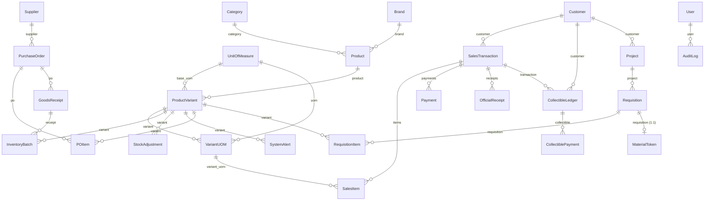

# SYSTEM ATLAS — BuildPro POS / Inventory System

> **Generated:** 2026-10-15 · **Refreshed:** 2026-10-16 (incremental — only the Flutter modules touched by the staged model swap, Phase 0 and Phase 1 were re-verified; the backend apps were **not** re-scanned) · **Branch:** `feature/backend-integration`
> **Method:** every claim below was verified against source — imports, route tables, model FKs, serializer fields, viewmodel bodies. `README.md`, `PHASE_*.md` and `ENDPOINTS.md` were **not** trusted.
> **Companion:** [`docs/system-atlas.html`](./system-atlas.html) — interactive cockpit (KPIs, filterable Truth Matrix, guided study path).

---

## 1. Architecture

Two processes, one database. A Flutter client talks to a Django REST API; the API owns **all** business logic and persists to PostgreSQL 15. The client currently exercises only a sliver of it.


**Request lifecycle.** Two features now complete the round trip end to end — auth, and (since Phase 1) the
products catalogue:

```text
login_page     → AuthViewmodel → AuthRepository → AuthService → ApiClient
               → POST /api/v1/auth/login/ → apps.users.views.login_view → SimpleJWT

products_page  → ProductsViewmodel → InventoryViewmodel.load()
               → ProductsRepository → ProductsService → ApiClient
               → GET /api/v1/products/ + GET /api/v1/batches/ → assembleCatalogue → CatalogueItem
```

The products path is worth noting for its *shape*: `InventoryViewmodel` is the product list's **only** home, so
loading that one store made the catalogue, the inventory screens and the POS catalogue read live data in a
single move. Decision 11 (`ProductsViewmodel` reads the store) and decision 12 (Phase 1 loads that store) were
chosen for exactly that reason. Every remaining feature still renders a hardcoded list. See the Truth Matrix in §3.

**Runtime topology** (`docker-compose.yml`): `buildpro_db` (postgres:15-alpine, host `5435`→`5432`) and `buildpro_backend` (runserver `:8000`, code bind-mounted from `backend_django/`).

---

## 2. Data model

Core erDiagram, derived from actual `ForeignKey`/`OneToOneField` declarations.



**Backbone tables** (25 models, 5 apps):

| App | Models | Notes |
| --- | --- | --- |
| `inventory` | 14 | Category, Brand, UnitOfMeasure, Product, ProductVariant, VariantUOM, Supplier, PurchaseOrder, POItem, GoodsReceipt, InventoryBatch, StockAdjustment, SystemAlert |
| `pos` | 5 | Customer, SalesTransaction, SalesItem, Payment, OfficialReceipt |
| `requisitions` | 4 | Project, Requisition, RequisitionItem, MaterialToken |
| `collectibles` | 2 | CollectibleLedger, CollectiblePayment |
| `users` | 2 | User (+ role), AuditLog |

`InventoryBatch` is the FIFO layer — `process_sale` deducts stock across batches in order.

---

## 3. Truth Matrix

Legend: 🟢 Live (real API) · 🟡 Partial · 🔴 Mock (hardcoded) · ⚫ Dead (never called)

| Feature / Screen | UI file (`flutter/lib/features/`) | ViewModel / State | Backend endpoint | Status |
| --- | --- | --- | --- | --- |
| Login | `auth/views/login_page.dart` | `auth/viewmodels/auth_viewmodel.dart` | `POST /api/v1/auth/login/` | 🟢 Live |
| Token refresh / logout / me | — (via `ApiClient`) | `auth_viewmodel` | `/auth/refresh/` `/auth/logout/` `/auth/me/` | 🟢 Live |
| Health probe | — | `data/services/health_service.dart` | `GET /api/health/` | 🟢 Live |
| Admin dashboard | `dashboard/views/admin_dashboard.dart` | `dashboard/viewmodels/dashboard_mock_data.dart` | — | 🔴 Mock |
| Inventory dashboard | `dashboard/views/inventory_dashboard.dart` | `dashboard_mock_data.dart` | — | 🔴 Mock |
| Inventory stock list | `inventory/views/inventory_stock_page.dart` | `inventory/viewmodels/inventory_viewmodel.dart` | `GET /api/v1/batches/` | 🟢 Live |
| Low stock | `inventory/views/inventory_low_stock_page.dart` | `inventory_viewmodel` | `GET /api/v1/alerts/` · derived in-client | 🟢 Live |
| Stock movements | `inventory/views/inventory_stock_movements_page.dart` | `inventory_viewmodel` | `GET /api/v1/adjustments/` | 🟡 Partial |
| Products | `products/views/products_page.dart` | `products/viewmodels/products_viewmodel.dart` | `GET /api/v1/products/` + `/batches/` | 🟢 Live |
| Categories | `categories/views/categories_page.dart` | `inventory_viewmodel` (was recorded as local state — wrong) | `GET /api/v1/categories/` | 🟡 Partial |
| Suppliers | `suppliers/views/suppliers_page.dart` | `suppliers_purchases_viewmodel` | `GET /api/v1/suppliers/` | 🔴 Mock |
| Purchases / PO | `suppliers/views/purchases_page.dart` | `suppliers_purchases_viewmodel` | `GET /api/v1/purchase-orders/` | 🔴 Mock |
| POS transaction | `pos/views/pos_transaction_page.dart` | `pos/viewmodels/pos_transaction_viewmodel.dart` | `POST /api/v1/transactions/` | 🟡 Partial |
| Sales dashboard | `sales/views/sales_dashboard_page.dart` | `sales/viewmodels/inventory_sales_viewmodel.dart` | — | 🔴 Mock |
| Sales transactions | `sales/views/sales_transactions_page.dart` | `inventory_sales_viewmodel` | `GET /api/v1/transactions/` | 🔴 Mock |
| Sales returns | `sales/views/sales_returns_page.dart` | `inventory_sales_viewmodel` | — | 🔴 Mock |
| Sales reports | `sales/views/sales_reports_page.dart` | `inventory_sales_viewmodel` | `GET /api/v1/reports/sales-summary/` | 🔴 Mock |
| Quotations | `sales/views/sales_quotations_page.dart` | `sales/viewmodels/sales_module_viewmodel.dart` | — (no backend model) | 🔴 Mock |
| Sales orders | `sales/views/sales_orders_page.dart` | `sales_module_viewmodel` | — (no backend model) | 🔴 Mock |
| Sales customers | `sales/views/sales_customers_page.dart` | `sales_module_viewmodel` | `GET /api/v1/customers/` | 🔴 Mock |
| Receivables / utang | `sales/views/sales_receivables_page.dart` | `sales_module_viewmodel` | `GET /api/v1/ledgers/` | 🔴 Mock |
| Inventory sales | `sales/views/inventory_sales_page.dart` | `inventory_sales_viewmodel` | `GET /api/v1/transactions/` | 🔴 Mock |
| Inventory returns | `sales/views/inventory_returns_page.dart` | `inventory_sales_viewmodel` | — | 🔴 Mock |
| Inventory reports | `reports/views/inventory_reports_page.dart` | reads `inventory_viewmodel` (was recorded as local state — wrong) | `GET /api/v1/reports/*` | 🟡 Partial |
| Admin users | `admin/views/admin_user_management_page.dart` | `admin/viewmodels/admin_mock_data.dart` | `GET /api/v1/users/` | 🔴 Mock |
| Admin audit logs | `admin/views/audit_logs_page.dart` | `admin_mock_data.dart` | `GET /api/v1/audit-logs/` | 🔴 Mock |
| Admin requisitions | `admin/views/requisitions_page.dart` | `admin_mock_data.dart` | `GET /api/v1/requisitions/` | 🔴 Mock |
| Admin reports | `admin/views/reports_page.dart` | `admin_mock_data.dart` | `GET /api/v1/reports/*` | 🔴 Mock |
| Admin monitoring (sales/inventory) | `admin/views/{sales,inventory}_monitoring_page.dart` | `admin_mock_data.dart` | `GET /api/v1/reports/*` | 🔴 Mock |
| Admin settings | `admin/views/settings_page.dart` | — (static) | — | 🔴 Mock |
| Sales dashboard (legacy) | `dashboard/views/sales_dashboard.dart` | `dashboard_mock_data.dart` | — | ⚫ Orphaned |
| POS dashboard (legacy) | `dashboard/views/pos_dashboard.dart` | `dashboard_mock_data.dart` | — | ⚫ Orphaned |
| Requisition token flow | **no UI** | — | `/tokens/verify/` `/tokens/release/` | ⚫ Dead |
| Collectibles CRUD | **no UI** | — | `/ledgers/` `/ledger-payments/` | ⚫ Dead |
| Goods receipts | **no UI** | — | `/goods-receipts/` | ⚫ Dead |
| Brands / UOMs / variant-UOMs | **no UI** | — | `/brands/` `/uoms/` `/variant-uoms/` | ⚫ Dead |
| Payments / receipts | **no UI** | — | `/payments/` `/receipts/` | ⚫ Dead |
| Project entity | **no UI** | — | `/projects/` | ⚫ Dead |

**Score: 6 live · 4 partial · 20 mock · 8 dead (38 rows).** Was 3 · 0 · 27 · 8.

Grading rule, so these are not vibes: 🟢 Live = the screen's *primary* data comes from an API response;
🟡 Partial = some of what it renders is live and the row's Notes say which; ⚫ Dead = never called.

Why they moved: `InventoryViewmodel` is the product list's only home, so **loading it once** (Phase 1) turned
the catalogue, the stock list and the low-stock list live together. The three Partial rows are those whose
**own** data is still local — movements (`_seedMovements`), category names (`InventoryMockData.categories`),
and the checkout POST (the cart reads live prices but `/transactions/` is unwired). `/brands/`, `/uoms/` and
`/variant-uoms/` stay dead as standalone endpoints: selling units now arrive nested inside `/products/`, and
the client never calls those routes directly.

---

## 4. Vibe-Debt Hotspots

### Duplicate / overlapping files

| Files | Verdict |
| --- | --- |
| `dashboard/views/pos_dashboard.dart` | ⚫ **Orphan.** `routes.dart` now builds `features/pos/views/pos_transaction_page.dart` for `posDashboard`. |
| `dashboard/views/sales_dashboard.dart` | ⚫ **Orphan.** Replaced by `features/sales/views/sales_dashboard_page.dart`. |
| `sales/viewmodels/sales_module_viewmodel.dart` (129 L) vs `sales/viewmodels/inventory_sales_viewmodel.dart` | **Two parallel sales stacks, no shared model.** `data/models/sales_module.dart` and `data/models/sales.dart` describe overlapping concepts. |
| `reports/views/inventory_reports_page.dart` · `sales/views/sales_reports_page.dart` · `admin/views/reports_page.dart` | **Three report screens** serving one backend `/api/v1/reports/*` surface. |
| `core/layout/sales_skeleton_layout.dart` (190 L) vs `core/layout/inventory_skeleton_layout.dart` (201 L) | Near-clone; diff is mostly nav labels. |

### Naming inconsistency

- `features/dashboard/widget/` and `features/auth/widget/` are **singular**; the other 8 features use `widgets/`.

### Wiring gaps

- ✅ **RESOLVED 2026-10-16 — this was never a defect.** `PosTransactionViewmodel` and `ProductsViewmodel` are
  still absent from `main.dart`'s `MultiProvider` (6 providers: auth, inventory, suppliers-purchases,
  inventory-sales, sales-module, product-tracking) and that is **correct**. Both are screen-scoped view state
  (decision 11); registering them would share one search box and one half-finished till cart across every
  navigation. `PosTransactionViewmodel` is provided at `pos_transaction_page.dart:35` and `ProductsViewmodel` at
  `products_page.dart`. The old "only 6 of 8 viewmodels are wired" framing assumed absence from `main.dart`
  meant not provided at all; it did not.
- `admin/viewmodels/admin_mock_data.dart` is consumed by **7** admin screens from one shared mock object.

### Disconnected endpoints

- **Wired today** (verified by grepping `lib/` for `/api/v1/` paths): the 5 auth routes, `api/health/`, and —
  new since this refresh — `GET /api/v1/products/` and `GET /api/v1/batches/`. That is **8 endpoints**. The rest
  of the backend inventory/POS/collectibles/requisitions surface is still reachable only via curl / the
  browsable API.
- Counts refreshed: **30 `GoRoute`s** in `routes.dart`. The previous revision said 24 routes (and 29 in the study
  path) — both were stale.
- **Lost integration code — now superseded, not merely recoverable.** Commit `22c7c26` added
  `flutter/lib/data/services/pos_service.dart` (+ `pos_repository.dart`) calling `/api/v1/products/` and
  `/api/v1/batches/`; merge `27a853e` dropped it. Phase 1 has since delivered that capability properly
  (`data/services/products_service.dart` + `products_repository.dart`, commit `b308717`). The old file is still
  worth reading as a **reference** (`git show 22c7c26 -- flutter/lib/data/services/pos_service.dart`) but must
  not be lifted wholesale: it hand-rolled `data['results']` instead of using `parsePaged` (decision 03), its DTO
  is POS-shaped rather than `CatalogueItem`, and it filters to `availableBaseStock > 0` — **wrong for a
  catalogue**, which must show out-of-stock products.

### Critical business logic (backend — no client consumer)

| Location | What it does |
| --- | --- |
| `apps/pos/services.py:28` `process_sale` | FIFO stock deduction, payment allocation, OR generation, collectibles posting on underpayment |
| `apps/requisitions/services.py:18` `generate_req_number` | Requisition numbering |
| `apps/requisitions/services.py:33` `approve_requisition` | DRAFT→APPROVED, mints `MaterialToken` |
| `apps/requisitions/services.py:50` `verify_token` | Token validation for the POS |
| `apps/requisitions/services.py:82` `release_materials` | Token redemption → FIFO deduct → `SalesTransaction` → ledger |
| `apps/collectibles/models.py` | Utang ledger + payment rollup |

---

## 5. Read-First Study Path

Read in this order. Items 4–8 are the files **newly wired in Phase 0 and Phase 1** — read 1–3 first for the
layers they sit on, then the new path top-down.

| # | File | Read | Why it matters |
| --- | --- | --- | --- |
| 1 | `flutter/lib/main.dart` (~90 L) | whole file | Bootstrap + the `MultiProvider` list. Six providers, and knowing **why** the other two are deliberately not here (decision 11) prevents re-adding them. |
| 2 | `flutter/lib/routes/routes.dart` (~360 L) | `redirectFor` (pure), the role map, the 30 routes | Single source of truth for navigation. `redirectFor` was extracted from the redirect closure so the routing rules are testable without rendering a dashboard. |
| 3 | `flutter/lib/core/network/api_client.dart` (~175 L) | `init()`, interceptors, `get`/`post`/`getList` | The only network layer: Dio setup, JWT storage, refresh-on-401. Note `init()` is **not idempotent** (`dio` is `late final`). |
| 4 | `flutter/lib/core/network/paged.dart` (~70 L) | whole file | **New (Phase 0).** Unwraps the DRF `{count,next,previous,results}` envelope in exactly one place (decision 03). `hasMore` comes from the `next` link, *not* the row count — the bug a review caught. |
| 5 | `flutter/lib/features/inventory/viewmodels/inventory_viewmodel.dart` (~250 L) | `load()`, `isLoading`/`loadError`/`hasLoaded`, `batchesFor`, `stockOnHandFor` | **New (Phase 1).** The product list's ONLY home, and therefore the hinge of the whole integration: loading it lights up products, inventory and POS at once. `load()` mutates in place (`_products`/`_batches` are `final List`) and on failure keeps the catalogue rather than emptying it. |
| 6 | `flutter/lib/data/services/products_service.dart` (~85 L) | whole file | **New (Phase 1).** The live fetch: both endpoints through `getList<T>`. Its test holds the decision-03 anti-regression — a body with no `results` list must **throw**, not return an empty catalogue. Worked example of the wired screen: `features/products/views/products_page.dart`. |
| 7 | `flutter/lib/core/widgets/async_view.dart` (~95 L) | whole file | **New (Phase 0).** Owns loading/error/empty/data for every data screen (decision 07); the precedence is baked in so the builder never runs without data. |
| 8 | `backend_django/apps/pos/services.py` (111 L) | L28-111 `process_sale` | **Next phase's money path** (Phase 3, gated by decision 06): FIFO deduction, payment allocation, OR generation, ledger posting behind one POST. Still unobserved — read from source only. |

---

## 6. Verification Notes

**Verified against source:** route tables (`config/urls.py`, `apps/*/urls.py`), model declarations + `ForeignKey` targets, `main.dart` provider list, `grep -rln ApiClient flutter/lib`, viewmodel bodies, `routes.dart` imports vs on-disk files.

**Not verified:**
- ✅ **Corrected 2026-10-16 — the old note here was wrong.** `flutter analyze` **is** clean on this branch, and
  `flutter/test/widget_test.dart` is **tracked**, not an untracked broken counter template: it is a real smoke
  test that asserts an unauthenticated launch lands on `LoginPage`. The suite is **146 tests, 0 failures**.
- The backend apps were **deliberately not re-scanned** in this refresh. The erDiagram and the
  critical-business-logic table are carried forward from 2026-10-15 and remain source-read, not observed.
- **`flutter run` has never been executed against the live backend.** The `/products/` and `/batches/`
  contracts *are* verified by probing the running server (count 6 and count 8 on 2026-10-16), but the running
  app has not been exercised — the widget tests use a fake adapter.
- The three viewmodels not using an API layer were checked by import/usage grep, not by runtime tracing.
- Known and deliberately unfixed: the products toolbar overflows (`A RenderFlex overflowed by 9.7 pixels`) from
  `products/widgets/products_toolbar.dart:113` and `products_catalog_overview.dart:156`, visible at ~1600px
  widths. Found while testing Phase 1; UI work outside that phase.
