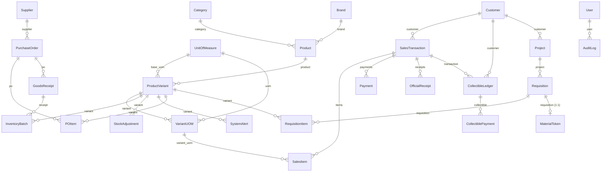

# SYSTEM ATLAS — BuildPro POS / Inventory System

> **Generated:** 2026-10-15 · **Branch:** `feature/backend-integration`
> **Method:** every claim below was verified against source — imports, route tables, model FKs, serializer fields, viewmodel bodies. `README.md`, `PHASE_*.md` and `ENDPOINTS.md` were **not** trusted.
> **Companion:** [`docs/system-atlas.html`](./system-atlas.html) — interactive cockpit (KPIs, filterable Truth Matrix, guided study path).

---

## 1. Architecture

Two processes, one database. A Flutter client talks to a Django REST API; the API owns **all** business logic and persists to PostgreSQL 15. The client currently exercises only a sliver of it.


**Request lifecycle.** Only one feature completes the round trip end to end:

```text
login_page → AuthViewmodel → AuthRepository → AuthService → ApiClient
          → POST /api/v1/auth/login/ → apps.users.views.login_view → SimpleJWT
```

Every other feature stops at the ViewModel — it renders a hardcoded list and never calls `ApiClient`. See the Truth Matrix in §3.

**Runtime topology** (`docker-compose.yml`): `buildpro_db` (postgres:15-alpine, host `5435`→`5432`) and `buildpro_backend` (runserver `:8000`, code bind-mounted from `backend_django/`).

---

## 2. Data model

Core erDiagram, derived from actual `ForeignKey`/`OneToOneField` declarations.



**Backbone tables** (25 models, 5 apps):

| App | Models | Notes |
| --- | --- | --- |
| `inventory` | 14 | Category, Brand, UnitOfMeasure, Product, ProductVariant, VariantUOM, Supplier, PurchaseOrder, POItem, GoodsReceipt, InventoryBatch, StockAdjustment, SystemAlert |
| `pos` | 5 | Customer, SalesTransaction, SalesItem, Payment, OfficialReceipt |
| `requisitions` | 4 | Project, Requisition, RequisitionItem, MaterialToken |
| `collectibles` | 2 | CollectibleLedger, CollectiblePayment |
| `users` | 2 | User (+ role), AuditLog |

`InventoryBatch` is the FIFO layer — `process_sale` deducts stock across batches in order.

---

## 3. Truth Matrix

Legend: 🟢 Live (real API) · 🟡 Partial · 🔴 Mock (hardcoded) · ⚫ Dead (never called)

| Feature / Screen | UI file (`flutter/lib/features/`) | ViewModel / State | Backend endpoint | Status |
| --- | --- | --- | --- | --- |
| Login | `auth/views/login_page.dart` | `auth/viewmodels/auth_viewmodel.dart` | `POST /api/v1/auth/login/` | 🟢 Live |
| Token refresh / logout / me | — (via `ApiClient`) | `auth_viewmodel` | `/auth/refresh/` `/auth/logout/` `/auth/me/` | 🟢 Live |
| Health probe | — | `data/services/health_service.dart` | `GET /api/health/` | 🟢 Live |
| Admin dashboard | `dashboard/views/admin_dashboard.dart` | `dashboard/viewmodels/dashboard_mock_data.dart` | — | 🔴 Mock |
| Inventory dashboard | `dashboard/views/inventory_dashboard.dart` | `dashboard_mock_data.dart` | — | 🔴 Mock |
| Inventory stock list | `inventory/views/inventory_stock_page.dart` | `inventory/viewmodels/inventory_viewmodel.dart` | `GET /api/v1/batches/` | 🔴 Mock |
| Low stock | `inventory/views/inventory_low_stock_page.dart` | `inventory_viewmodel` | `GET /api/v1/alerts/` | 🔴 Mock |
| Stock movements | `inventory/views/inventory_stock_movements_page.dart` | `inventory_viewmodel` | `GET /api/v1/adjustments/` | 🔴 Mock |
| Products | `products/views/products_page.dart` | `products/viewmodels/products_viewmodel.dart` | `GET /api/v1/products/` | 🔴 Mock |
| Categories | `categories/views/categories_page.dart` | — (local state) | `GET /api/v1/categories/` | 🔴 Mock |
| Suppliers | `suppliers/views/suppliers_page.dart` | `suppliers_purchases_viewmodel` | `GET /api/v1/suppliers/` | 🔴 Mock |
| Purchases / PO | `suppliers/views/purchases_page.dart` | `suppliers_purchases_viewmodel` | `GET /api/v1/purchase-orders/` | 🔴 Mock |
| POS transaction | `pos/views/pos_transaction_page.dart` | `pos/viewmodels/pos_transaction_viewmodel.dart` | `POST /api/v1/transactions/` | 🔴 Mock |
| Sales dashboard | `sales/views/sales_dashboard_page.dart` | `sales/viewmodels/inventory_sales_viewmodel.dart` | — | 🔴 Mock |
| Sales transactions | `sales/views/sales_transactions_page.dart` | `inventory_sales_viewmodel` | `GET /api/v1/transactions/` | 🔴 Mock |
| Sales returns | `sales/views/sales_returns_page.dart` | `inventory_sales_viewmodel` | — | 🔴 Mock |
| Sales reports | `sales/views/sales_reports_page.dart` | `inventory_sales_viewmodel` | `GET /api/v1/reports/sales-summary/` | 🔴 Mock |
| Quotations | `sales/views/sales_quotations_page.dart` | `sales/viewmodels/sales_module_viewmodel.dart` | — (no backend model) | 🔴 Mock |
| Sales orders | `sales/views/sales_orders_page.dart` | `sales_module_viewmodel` | — (no backend model) | 🔴 Mock |
| Sales customers | `sales/views/sales_customers_page.dart` | `sales_module_viewmodel` | `GET /api/v1/customers/` | 🔴 Mock |
| Receivables / utang | `sales/views/sales_receivables_page.dart` | `sales_module_viewmodel` | `GET /api/v1/ledgers/` | 🔴 Mock |
| Inventory sales | `sales/views/inventory_sales_page.dart` | `inventory_sales_viewmodel` | `GET /api/v1/transactions/` | 🔴 Mock |
| Inventory returns | `sales/views/inventory_returns_page.dart` | `inventory_sales_viewmodel` | — | 🔴 Mock |
| Inventory reports | `reports/views/inventory_reports_page.dart` | — (local state) | `GET /api/v1/reports/*` | 🔴 Mock |
| Admin users | `admin/views/admin_user_management_page.dart` | `admin/viewmodels/admin_mock_data.dart` | `GET /api/v1/users/` | 🔴 Mock |
| Admin audit logs | `admin/views/audit_logs_page.dart` | `admin_mock_data.dart` | `GET /api/v1/audit-logs/` | 🔴 Mock |
| Admin requisitions | `admin/views/requisitions_page.dart` | `admin_mock_data.dart` | `GET /api/v1/requisitions/` | 🔴 Mock |
| Admin reports | `admin/views/reports_page.dart` | `admin_mock_data.dart` | `GET /api/v1/reports/*` | 🔴 Mock |
| Admin monitoring (sales/inventory) | `admin/views/{sales,inventory}_monitoring_page.dart` | `admin_mock_data.dart` | `GET /api/v1/reports/*` | 🔴 Mock |
| Admin settings | `admin/views/settings_page.dart` | — (static) | — | 🔴 Mock |
| Sales dashboard (legacy) | `dashboard/views/sales_dashboard.dart` | `dashboard_mock_data.dart` | — | ⚫ Orphaned |
| POS dashboard (legacy) | `dashboard/views/pos_dashboard.dart` | `dashboard_mock_data.dart` | — | ⚫ Orphaned |
| Requisition token flow | **no UI** | — | `/tokens/verify/` `/tokens/release/` | ⚫ Dead |
| Collectibles CRUD | **no UI** | — | `/ledgers/` `/ledger-payments/` | ⚫ Dead |
| Goods receipts | **no UI** | — | `/goods-receipts/` | ⚫ Dead |
| Brands / UOMs / variant-UOMs | **no UI** | — | `/brands/` `/uoms/` `/variant-uoms/` | ⚫ Dead |
| Payments / receipts | **no UI** | — | `/payments/` `/receipts/` | ⚫ Dead |
| Project entity | **no UI** | — | `/projects/` | ⚫ Dead |

**Score: 3 live · 0 partial · 27 mock · 9 dead.**

---

## 4. Vibe-Debt Hotspots

### Duplicate / overlapping files

| Files | Verdict |
| --- | --- |
| `dashboard/views/pos_dashboard.dart` | ⚫ **Orphan.** `routes.dart` now builds `features/pos/views/pos_transaction_page.dart` for `posDashboard`. |
| `dashboard/views/sales_dashboard.dart` | ⚫ **Orphan.** Replaced by `features/sales/views/sales_dashboard_page.dart`. |
| `sales/viewmodels/sales_module_viewmodel.dart` (129 L) vs `sales/viewmodels/inventory_sales_viewmodel.dart` | **Two parallel sales stacks, no shared model.** `data/models/sales_module.dart` and `data/models/sales.dart` describe overlapping concepts. |
| `reports/views/inventory_reports_page.dart` · `sales/views/sales_reports_page.dart` · `admin/views/reports_page.dart` | **Three report screens** serving one backend `/api/v1/reports/*` surface. |
| `core/layout/sales_skeleton_layout.dart` (190 L) vs `core/layout/inventory_skeleton_layout.dart` (201 L) | Near-clone; diff is mostly nav labels. |

### Naming inconsistency

- `features/dashboard/widget/` and `features/auth/widget/` are **singular**; the other 8 features use `widgets/`.

### Wiring gaps

- `PosTransactionViewmodel` and `ProductsViewmodel` exist but are **not registered** in `main.dart`'s `MultiProvider` (only 6 of 8 viewmodels are).
- `admin/viewmodels/admin_mock_data.dart` is consumed by **7** admin screens from one shared mock object.

### Disconnected endpoints

- **All 24 router routes + 4 report paths are uncalled by the client.** The only wired endpoints are the 5 auth routes plus `api/health/`. The entire inventory/POS/collectibles/requisitions surface is reachable only via curl / the browsable API.
- Lost integration code: commit `22c7c26` added `flutter/lib/data/services/pos_service.dart` (+ `pos_repository.dart`) calling `/api/v1/products/` and `/api/v1/batches/`. The later merge `27a853e` **dropped it**; it is absent at the tip. Recoverable with `git show 22c7c26 -- flutter/lib/data/services/pos_service.dart`.

### Critical business logic (backend — no client consumer)

| Location | What it does |
| --- | --- |
| `apps/pos/services.py:28` `process_sale` | FIFO stock deduction, payment allocation, OR generation, collectibles posting on underpayment |
| `apps/requisitions/services.py:18` `generate_req_number` | Requisition numbering |
| `apps/requisitions/services.py:33` `approve_requisition` | DRAFT→APPROVED, mints `MaterialToken` |
| `apps/requisitions/services.py:50` `verify_token` | Token validation for the POS |
| `apps/requisitions/services.py:82` `release_materials` | Token redemption → FIFO deduct → `SalesTransaction` → ledger |
| `apps/collectibles/models.py` | Utang ledger + payment rollup |

---

## 5. Read-First Study Path

Read in this order. Each is the authority for its layer.

| # | File | Read | Why it matters |
| --- | --- | --- | --- |
| 1 | `flutter/lib/main.dart` (45 L) | whole file | Bootstrap + the `MultiProvider` list — reveals which 6 viewmodels are actually global. |
| 2 | `flutter/lib/routes/routes.dart` (323 L) | L60-90 (redirect/role map), L140-320 (29 routes) | Single source of truth for navigation; shows which screens are reachable and the `/inventory/` and `/sales/` guards. |
| 3 | `flutter/lib/core/network/api_client.dart` (148 L) | L60-140 | The **only** network layer: Dio setup, JWT storage, refresh-on-401. Everything live flows through here. |
| 4 | `backend_django/config/urls.py` (46 L) | whole file | Complete API surface in 6 `include()`s. |
| 5 | `backend_django/apps/pos/services.py` (111 L) | L28-111 `process_sale` | The money path: FIFO deduction, payments, receipts, ledger posting. |
| 6 | `backend_django/apps/requisitions/services.py` (169 L) | L33-169 | Full token lifecycle: approve → mint → verify → release. The CPMS integration contract lives here. |
| 7 | `backend_django/apps/inventory/models.py` (321 L) | L73-140 (Product/Variant), L244-300 (Batch/Adjustment) | The 14-model catalogue; `InventoryBatch` is what FIFO walks. |
| 8 | `flutter/lib/features/sales/viewmodels/sales_module_viewmodel.dart` (129 L) | L1-40 | Canonical mock-data viewmodel — the pattern to replace during backend integration. |

---

## 6. Verification Notes

**Verified against source:** route tables (`config/urls.py`, `apps/*/urls.py`), model declarations + `ForeignKey` targets, `main.dart` provider list, `grep -rln ApiClient flutter/lib`, viewmodel bodies, `routes.dart` imports vs on-disk files.

**Not verified:**
- No `flutter analyze` on this branch at time of writing (one known error exists in the untracked `flutter/test/widget_test.dart`).
- Backend behaviour was not re-executed here; `process_sale` semantics are read from source, not observed.
- The three viewmodels not using an API layer were checked by import/usage grep, not by runtime tracing.
