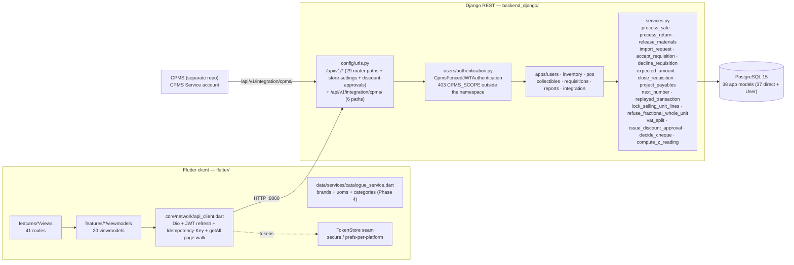

# SYSTEM ATLAS — BuildPro POS / Inventory System

> **Generated:** 2026-10-15 · **Refreshed:** 2026-11-11 · **Branch:** `feat/pos-evolution-phase-4` (off Phase 1d `c8ef41f`, uncommitted). **Status:** Phase 4 ✅ Done, owner closed with five Minors deferred; gates and isolated QA passed. Dev read-only recheck now shows Phase 4 migrations applied after external restart; assistant did not migrate/reset. Seed state unverified. Phase 1d ✅ Done 2026-11-11 (owner closed with accepted limits); Phase 1b closed 2026-11-08 with explicitly owner-accepted QA limits. Contract v0.3 provisionally owner-accepted 2026-11-11. Not deployed. Canonical progress/evidence: [Phase 4 plan](../planning/pos-evolution/phase-4-plan.md) · decision [18 Panel feedback](../planning/pos-evolution/decisions/18-panel-feedback-2026-11.md) · [Phase 1d plan](../planning/pos-evolution/phase-1d-plan.md).
> **Method:** Phase 4 flags, counts and cross-references re-checked against source — `routes.dart` `GoRoute(` declarations, `viewmodels/*.dart` classes, `data/services/*.dart` `api_client` imports, `main.dart` providers, `models.py` class bases and `urls.py` registrations. Phase 1b/1d history retained where still true; historical unrelated debt/study notes retained, not newly QA-verified. `README.md`, `PHASE_*.md` and `ENDPOINTS.md` were **not** treated as source truth.
> **Companion:** [`docs/system-atlas.html`](./system-atlas.html) — interactive cockpit (KPIs, filterable Truth Matrix, guided study path).

---

## 1. Architecture

Two processes, one database. A Flutter client talks to a Django REST API; the API owns **all** business logic and persists to PostgreSQL 15. Data screens read API responses; store contact constants and access-scope banners remain static (VAT and discount settings are now API-backed) — zero `*MockData`/`Simulator` files remain in `lib/` (all deleted; only comments reference the mock era, and Phase 1d removed the last fake one). The server is the trust boundary: Phase 1 (server price/UOM authority, `INVALID_SALE` validation, credit-limit block, locked `DocumentCounter`, `Idempotency-Key` de-dupe) · Phase 2 (Admin-group authority + `LAST_ADMIN`, cashier-own scoping, token secrecy) · Phase 3 (open-shift gate, debt-first returns with `RETURN_CREDIT`) · Phase 4 (catalog persistence, two-step receive+process, append-only records) · Phase 5 (`IsUserManagerRole`: Store Manager user-write with `USER_ADMIN_FORBIDDEN` guardrails, manager-only unlinked returns) · Phase 6 (unique `barcode_qr` per selling unit — factory EAN/UPC GS1-checked or auto-derived `QB` code; `?barcode=` lookup; till scans resolve the unit with server fallback; 50×30 mm Code 128 stickers from Products + Receiving; per-unit code edit) · POS evolution Phase 1 (`CPMS Service` role behind `CpmsFencedJWTAuthentication`: 403 `CPMS_SCOPE` outside `/api/v1/integration/cpms/`; CPMS pushes approved requests, imported contents stay read-only). Phase 1b adds the store's separate Accept/Decline decision before release; only accepted lines can leave, `PARTIAL` keeps the token alive, and utang carries the project. Phase 1d moves what a whole unit means onto the server (`UnitOfMeasure.is_whole`), seeds the twelve standard units in every database, lets a store remove an unused selling unit, and refuses a fractional quantity on a whole-count unit on every path that carries one. POS evolution Phase 4 (front counter, decision 18): shelf prices are VAT-inclusive and the server splits `vatable_sales`/`vat_amount` from the net, storing a per-sale `vat_rate` (returns use the sale's rate; legacy null = 0%); Admin-only `StoreSettings` holds VAT on/rate and the discount cap; a cashier discount needs a reason and stays within the Admin cap unless a Store Manager/Admin approves on the spot through a one-time 5-minute signed token (`POST /discount-approvals/`; five failures lock the pair, 429 `DISCOUNT_APPROVAL_LOCKED`, password never stored); split tenders record a server `change_given` from cash only, and a non-cash overpay is refused 400 `PAYMENT_EXCEEDS_TOTAL`; customer cheques are `PENDING`/`CLEARED`/`BOUNCED` and never reduce debt until a manager clears them; accounts carry several roles (`roles[]`) with an area picker and header switcher; shared `DataPanel` pages at 25 rows; Products exports a barcode PDF/CSV masterlist whose CSV prefixes formula-leading cells with `'`. Contract for CPMS: [`docs/integration/CPMS-CONTRACT.md`](./integration/CPMS-CONTRACT.md) (v0.3, owner provisionally accepted 2026-11-11; v0.2 closed 2026-11-08 with accepted QA limits).



**Request lifecycle.** The two oldest paths, plus the Phase 1 checkout contract:

```text
login_page → AuthViewmodel → AuthService → POST /api/v1/auth/login/ → SimpleJWT
products_page → ProductsViewmodel → InventoryViewmodel.load() → GET /products/ + /batches/
checkout → PosTransactionViewmodel (owns attempt key) → POST /transactions/ [Idempotency-Key]
  → process_sale: validate → shift gate → server price → base_qty × CF → FIFO → receipt
```

`InventoryViewmodel` is the product list's **only** home (decisions 11/12).

### Phase 1b — project request lifecycle

- Import → `WAITING` (line `available=null`). CPMS approval is not store acceptance. Store Manager/Admin answers once: `ACCEPTED` with every line explicitly true/false and at least one true, or whole `DECLINED` with a reason. Strict JSON booleans only; false requires a trimmed reason, true requires no reason; unexpected fields and quantity/price/status edits are refused. Accept reserves no stock and books no money.
- `available` is three-valued **store intent**, not live shelf `availability`. False lines never consume stock or hold completion open. Only `ACCEPTED`/`PARTIAL` releases; all eligible lines finished → `RELEASED`, even with truthful outstanding quantities on false lines. `WAITING`/`DECLINED` scans return typed `REQUISITION_<STATUS>` before generic token-used checks.
- Accept/Decline/Close/Release share token→request row-lock order and re-read fresh state. `PARTIAL` keeps the token live; `RELEASED`/`DECLINED`/`CLOSED` spend it. CPMS may close `WAITING`/`ACCEPTED`/`PARTIAL`; closing terminal states is a no-op (legacy `CANCELLED` remains 409).
- Nullable persisted `released_amount` accumulates known **persisted sale totals** only. `expected_amount` = known released total + sum(current selling price × true-line outstanding), outstanding sum rounded once `ROUND_HALF_UP`. It is a live budget, independent of debt/payments, not a quote. Unknown historical totals stay null across future releases; WAITING/DECLINED/unreviewed legacy rows have no budget. CLOSED after acceptance retains abandoned accepted shortfall; CLOSED before review stays null. CPMS read-back adds decisions/reasons/budget, not unit prices, stock or token.
- Two new URLs, one shared queue body/VM: `/admin/project-requests` (sidebar **7**) and `/sales/project-requests` (**8**), appended without renumbering; `salesTwinOf` keeps managers in their shell. CPMS approver stays separate from store reviewer/audit. Old approvals URLs and foreman stay retired.
- Queue is oldest-first, selected-status page walk with a fail-loud **40 × 50 = 2000-row** bound; not a silent completeness claim. Badge uses server `Paged.total` for all WAITING, independent of search/status selection; failed reads are not zero. Unknown write outcomes/unreadable successes and 409 reload authoritative detail before retry; failed refresh blocks actions. Latest-generation reads and dispose-safe notifications guard async state; saved-but-stale copy distinguishes success from refresh failure.

Sources: [services](../backend_django/apps/requisitions/services.py), [review serializers](../backend_django/apps/requisitions/serializers.py), [views](../backend_django/apps/requisitions/views.py), [queue VM](../flutter/lib/features/requisitions/viewmodels/project_requests_viewmodel.dart), [service](../flutter/lib/data/services/requisition_service.dart), [role shells](../flutter/lib/features/requisitions/views/project_requests_page.dart), [routes](../flutter/lib/routes/routes.dart).

### Phase 1d — the unit decides, not the client

- `UnitOfMeasure.is_whole` (boolean, default false) is the one source of truth for "counted in ones". [Migration 0008](../backend_django/apps/inventory/migrations/0008_uom_is_whole.py) adds the column and seeds **12 standard units** in every database (`PC`, `BAG`, `BOX`, `PACK`, `ROLL`, `SHEET` whole; `KG`, `G`, `M`, `CM`, `L`, `ML` measured). Lookups are case-insensitive because codes are unique only case-sensitively, an existing row is flagged rather than recased, and `RL` is accepted as the Roll row so no second Roll is created. The reverse direction deliberately deletes nothing: selling units and past lines may point at those rows.
- The Flutter client no longer carries a code list. `lib/core/units/whole_units.dart` is deleted; the till reads `uom_is_whole` off the selling unit, and the details dialog prints `Whole` or `Measured` in words, not colour alone.
- One refusal, one code: `common/exceptions.py` `WholeUnitQuantity` (400 `WHOLE_UNIT_QUANTITY`, detail naming the line, product and unit) with the shared `refuse_fractional_whole_unit` helper. The rule lives in `common/` because it spans both directions of the app dependency graph — the POS validator, the quotation/sales-order/purchase-order serializers, the goods-receipt view, the stock-adjustment serializer and the CPMS import all ask it, and none of them may import another app's API module to do so. Every raise site checks **before the first write**, so the 400 also means nothing changed. Paths refusing: sale, held-cart complete, return, release, quotation, sales order, purchase order, goods receipt, stock adjustment, CPMS import.
- `unit_is_whole` / `uom_is_whole` / `in_use` are read-only on the serializers. `in_use` is one query via `annotate_unit_in_use`, so a list of products costs no N+1.
- `DELETE /api/v1/variant-uoms/{id}/` removes an **unused** extra selling unit. 400 `BASE_UNIT_REQUIRED` for the factor-1 unit (removing it would leave every quantity counted in a unit the product no longer has); 400 `SELLING_UNIT_IN_USE` when any of the five PROTECT tables references it (sale line, held cart, project request, quotation, sales order); 404 for a bad id and for a second delete of the same row, never a 500. Price and code stay editable either way; the audit row is written inside the same transaction, so a success is 204 plus one `DELETE` row and a refusal writes nothing.
- Removal and the writers share a lock: `apps/inventory/services.py` `lock_selling_units` / `lock_selling_unit_lines` take `select_for_update()` in **sorted PK order** over the units a write is about to reference. Removal takes the same row lock, so the read-then-write window is closed in both directions and two writers queue in one order instead of deadlocking. A unit that vanished between read and lock becomes 400 `SELLING_UNIT_IN_USE` naming the line, not a foreign-key 500.
- `seed_demo` demonstrates the contrast on one product: Tile Adhesive sells as `KG` (measured, so 2.5 kg is legal) and as `BAG` = 25 kg through a real purchase order plus receiving, so the packaged unit is stock-backed rather than typed in by hand.

Sources: [model](../backend_django/apps/inventory/models.py), [migration](../backend_django/apps/inventory/migrations/0008_uom_is_whole.py), [refusal](../backend_django/common/exceptions.py), [locks](../backend_django/apps/inventory/services.py), [removal view](../backend_django/apps/inventory/views.py), [selling-unit fields](../flutter/lib/features/products/widgets/selling_unit_fields.dart), [seed](../backend_django/apps/users/management/commands/seed_demo.py).

### Phase 4 — front counter

- **Settings.** `StoreSettings` is a database-enforced singleton (`pk=1` check constraint): `vat_registered` (default true), `vat_rate` (12.00), `discount_cap_percent` (10.00). `GET /api/v1/store-settings/` for any signed-in user, `PATCH` Admin only, audited. The Admin Settings page edits these through the app-scoped `StoreSettingsViewmodel`; store name/email/phone remain inline constants.
- **VAT.** Shelf prices include VAT, so `vat_split` works backwards from the net: `vatable_sales = net / (1 + rate/100)`, `vat_amount = net − vatable_sales`, `ROUND_HALF_UP` once. Non-VAT stores get 0/0 and a flag. Each sale stores its own `vat_rate` (pos 0013), so a linked return refunds under the rate the sale was made at; legacy rows hold null and read as 0%, and an unlinked return has no original to read and uses today's settings.
- **Discount.** Optional `discount {kind: AMOUNT|PERCENT, value, reason}` on checkout and held-cart complete; percent is of gross, reason required above zero, never above gross. Above the cap the sale needs a `discount_approval` token from `POST /api/v1/discount-approvals/`: Store Manager/Admin credentials checked server-side, never stored; the token is a signature over a `DiscountApproval` row, bound to the percent, valid 5 minutes and spent under a row lock by one sale. A cashier cannot approve themselves. The endpoint shares the login lockout (`apps.users.lockout`): five failures per (username, address) answer 429 `DISCOUNT_APPROVAL_LOCKED`, each failure audited without the password. Returns refund each line's net share (line gross × sale net ÷ sale gross). Reports show Discounts and VAT again.
- **Split tenders and change.** `payments[]` may mix cash, GCash and cheque. The server computes `change_given` (pos 0014): money in hand above the net, capped at cash tendered; a non-cash overpay is refused 400 `PAYMENT_EXCEEDS_TOTAL`. The Z-reading subtracts change from `cash_sales`, which fixes a pre-existing drawer overstatement QA found on any cash overpay. The receipt prints the server's change.
- **Cheques.** No new model: a cheque is a `Payment` row with `method=CHEQUE`, `cheque_number`/`bank`/`cheque_date` and `status` `PENDING`/`CLEARED`/`BOUNCED` (other methods `CLEARED`; pos 0012 backfills old rows). A cheque needs a named customer (`CHEQUE_NEEDS_CUSTOMER`). A pending cheque is not paid: its amount posts to the customer's utang ledger, linked by `Payment.ledger`, and only `POST /cheques/{id}/clear/` applies a ledger payment; `bounce/` (reason) leaves it owed. Store Manager/Admin only, once-only 409 `CHEQUE_ALREADY_DECIDED`, locked and audited. Utang payments offer the same cheque option (collectibles 0003 shares the method choice). Refunds never pay out by cheque.
- **Several roles.** User serializer returns `roles[]` (recognized staff areas, deduplicated in stable order; CPMS/ad-hoc groups excluded) beside legacy `role`; admin writes send `roles[]` as a full replacement, with `USER_ADMIN_FORBIDDEN`/`LAST_ADMIN` applying to every role added or removed and `CPMS Service` never combinable with staff roles. Client: one area signs straight in; several land on `/select-area` (`AreaPickerPage`, the 41st route); the header `AreaSwitcherMenu` changes area; `redirectFor` honours a stored choice only while the server still assigns it (`active_area_store.dart`, per device).
- **Pager and labels.** `DataPanel` pages client-side at 25 rows ("1 to 25 of N", hidden at 25 or fewer, `paginate: false` opt-out, reset on filter). Products gains a **Barcode list** export (`features/labels/barcode_list_{document,csv,dialog}.dart`): A4 PDF with EAN only on a valid check digit, else Code 128; CSV with BOM and a `'` prefix on cells starting `=`, `+`, `-`, `@`, tab or CR.

Sources: [models](../backend_django/apps/pos/models.py), [services](../backend_django/apps/pos/services.py), [views](../backend_django/apps/pos/views.py), [role serializer](../backend_django/apps/users/serializers.py), [routes](../flutter/lib/routes/routes.dart), [area picker](../flutter/lib/features/auth/views/area_picker_page.dart), [cheque queue VM](../flutter/lib/features/sales/viewmodels/cheque_queue_viewmodel.dart), [settings VM](../flutter/lib/features/admin/viewmodels/store_settings_viewmodel.dart), [barcode CSV](../flutter/lib/features/labels/barcode_list_csv.dart).

---

## 2. Data model

Core erDiagram, derived from actual `ForeignKey`/`OneToOneField` declarations. Phase 1 additions marked ★.

```mermaid
erDiagram
  Category       ||--o{ Product : "category"
  Brand          ||--o{ Product : "brand"
  UnitOfMeasure  ||--o{ ProductVariant : "base_uom"
  Product        ||--o{ ProductVariant : "product"
  ProductVariant ||--o{ VariantUOM : "variant"
  UnitOfMeasure  ||--o{ VariantUOM : "uom"
  ProductVariant ||--o{ InventoryBatch : "variant"
  ProductVariant ||--o{ StockAdjustment : "variant"
  ProductVariant ||--o{ SystemAlert : "variant"
  Supplier       ||--o{ PurchaseOrder : "supplier"
  PurchaseOrder  ||--o{ POItem : "po"
  PurchaseOrder  ||--o{ GoodsReceipt : "po"
  GoodsReceipt   ||--o{ GoodsReceiptItem : "★ lines"
  POItem         ||--o{ GoodsReceiptItem : "po_item"
  ProductVariant ||--o{ POItem : "variant"
  GoodsReceipt   ||--o{ InventoryBatch : "receipt"
  Customer       ||--o{ Quotation : "customer"
  Quotation      ||--o{ QuotationItem : "items"
  Quotation      ||--o| SalesOrder : "quotation"
  Customer       ||--o{ SalesOrder : "customer"
  SalesOrder     ||--o{ SalesOrderItem : "items"
  SalesTransaction ||--o{ SalesItemDeduction : "deductions"
  Customer       ||--o{ SalesTransaction : "customer"
  SalesTransaction ||--o{ SalesItem : "items"
  SalesTransaction ||--o{ Payment : "payments"
  SalesTransaction ||--o{ OfficialReceipt : "receipts"
  VariantUOM     ||--o{ SalesItem : "variant_uom"
  Customer       ||--o{ CollectibleLedger : "customer"
  SalesTransaction ||--o{ CollectibleLedger : "transaction"
  CollectibleLedger ||--o{ CollectiblePayment : "collectible"
  Customer       ||--o{ Project : "customer"
  Project        ||--o{ Requisition : "project"
  Project        ||--o{ CollectibleLedger : "project (null for counter sales)"
  Requisition    ||--o{ RequisitionItem : "requisition"
  Requisition    ||--o| MaterialToken : "requisition (1:1)"
  VariantUOM     ||--o{ RequisitionItem : "variant_uom"
  User           ||--o{ AuditLog : "user"
  User           ||--o{ HeldCart : cashier
  Customer       ||--o{ HeldCart : customer
  HeldCart       ||--o{ HeldCartItem : items
  User           ||--o{ Shift : cashier
  Shift          ||--o{ SalesTransaction : shift
  CollectibleLedger ||--o{ Payment : "P4 cheque ledger"
  User           ||--o{ Payment : "P4 cheque decided_by"
  User           ||--o{ DiscountApproval : "P4 approver"
  SalesTransaction ||--o{ DiscountApproval : "P4 spent by"
  DocumentCounter : "★ standalone lock row (prefix, day)"
  StoreSettings : "P4 singleton pk=1"
```

**App-owned concrete model classes:** 38 across 7 local Django apps: **37 direct `models.Model` subclasses + custom User** (Phase 4 adds `StoreSettings` and `DiscountApproval` in `pos`; cheques are `Payment` rows, not a model). AST direct-base counting alone excludes User; source actually uses `AbstractBaseUser, PermissionsMixin`, **not `AbstractUser`**. Counts exclude Django/contrib models and implicit M2M tables. `reports` and `integration` have no models; Phase 1b and Phase 1d added fields, not entities.

| App | Models | Notes |
| --- | --- | --- |
| `inventory` | 14 | `GoodsReceiptItem` per-receipt lines, `processed_at` lock flag; `Category.is_active` persists archive/restore (products remain sellable); `UnitOfMeasure.is_whole` marks units counted in ones (migration `inventory.0008`, which also seeds 12 standard units) |
| `pos` | 16 | `DocumentCounter` locked numbering; `idempotency_key` + `request_hash` (partial unique on cashier+key); `Shift` FK on sale, return, release. Phase 4: `StoreSettings` singleton, `DiscountApproval` one-time token row; sale `discount_reason`, `vat_registered`, `vat_rate`, `change_given`; `Payment` cheque fields + `status` + `ledger`/`decided_by` (migrations 0011–0014) |
| `requisitions` | 4 | Project, Requisition, RequisitionItem, MaterialToken. `cpms_project_id` / `cpms_request_id` (unique, nullable) find a re-pushed copy; `requester_name` / `approver_name` are plain names (no foreman FK); `WAITING` → `ACCEPTED`/`DECLINED`, then `PARTIAL`/`RELEASED`/`CLOSED`; nullable `released_amount`; selling `VariantUOM` lines carry `released_qty`, nullable `available` and reasons |
| `collectibles` | 2 | CollectibleLedger (+ nullable `project` FK, set by `release_materials` only; serializer adds `project_name`), CollectiblePayment |
| `users` | 2 | AuditLog + custom User (`AbstractBaseUser, PermissionsMixin`; only AuditLog directly extends `models.Model`). Roles: Admin, System Administrator, Store Manager, Stock Manager, Cashier, `CPMS Service` (in no `*_ROLES` list); `Site Foreman` retired by `requisitions.0002`. Phase 4: several groups per account exposed as `roles[]`; migrations 0003–0004 change audit action choices only |
| `reports` | 0 | Four report views, no app-owned models |
| `integration` | 0 | `/api/v1/integration/cpms/`: `customers/`, `materials/`, `requests/` (import), `requests/{id}/` (read-back), `requests/{id}/close/`, `projects/{id}/payables/` — all `IsCpmsService` |

`Customer.total_credit_limit` is now nullable: null = unlimited, 0 = no credit (migration `pos.0008`). `UnitOfMeasure.is_whole` is the Phase 1d field equivalent of that: a flag on an existing row, so no ER edge changed and `VariantUOM` still owns price, code and conversion factor. `VariantUOM` gained no column; its removal is a `DELETE` guarded by the five PROTECT tables that already existed.

---

## 3. Truth Matrix

Legend: 🟢 Live (feature's *primary* data comes from an API response; not a completeness/QA claim) · 🟡 Partial (static non-API scope/constants here, not mock business data) · 🔴 Mock (hardcoded business data) · ⚫ Dead (no production caller/retired feature). Selected feature inventory, not one row per route.

| Feature / Screen | UI file (`flutter/lib/features/`) | ViewModel / State | Backend endpoint | Status |
| --- | --- | --- | --- | --- |
| Login | `auth/views/login_page.dart` | `auth/viewmodels/auth_viewmodel.dart` | `POST /api/v1/auth/login/` | 🟢 Live |
| Token refresh / logout / me | — (via `ApiClient`) | `auth_viewmodel` | `/auth/refresh/` `/auth/logout/` `/auth/me/` | 🟢 Live |
| Health probe | — | `data/services/health_service.dart` | `GET /api/health/` | 🟢 Live |
| Admin dashboard | `dashboard/views/admin_dashboard.dart` | `dashboard/viewmodels/admin_overview_viewmodel.dart` | `GET /api/v1/reports/sales-summary/` + transactions + inventory | 🟢 Live |
| Inventory dashboard | `dashboard/views/inventory_dashboard.dart` | `inventory/viewmodels/inventory_viewmodel.dart` | products + batches + adjustments | 🟢 Live |
| Inventory stock list | `inventory/views/inventory_stock_page.dart` | `inventory/viewmodels/inventory_viewmodel.dart` | `GET /api/v1/batches/` | 🟢 Live |
| Low stock | `inventory/views/inventory_low_stock_page.dart` | `inventory_viewmodel` | `GET /api/v1/alerts/` | 🟢 Live |
| Stock adjustments (legacy stock-movements URL) | `inventory/views/inventory_stock_movements_page.dart` | `inventory_viewmodel` | `GET /api/v1/adjustments/` | 🟢 Live (adjustments only; no sales/receipts or simulator; Phase 1d refuses a fractional count on a whole base unit) |
| Products | `products/views/products_page.dart` | `products/viewmodels/products_viewmodel.dart` | `GET /api/v1/products/` + `/batches/` | 🟢 Live |
| Categories | `categories/views/categories_page.dart` | `CategoriesViewModel` (live CRUD + archive/restore) | `GET/POST/PATCH /api/v1/categories/` | 🟢 Live |
| Suppliers | `suppliers/views/suppliers_page.dart` | `suppliers_purchases_viewmodel` → `SupplierRepository` | `GET /api/v1/suppliers/` | 🟢 Live |
| Purchases / PO | `suppliers/views/purchases_page.dart` | `suppliers_purchases_viewmodel` → `SupplierRepository` | `GET /api/v1/purchase-orders/` | 🟢 Live |
| POS transaction | `pos/views/pos_transaction_page.dart` (receipt dialog prints an 80 mm PDF via `pos/widgets/receipt_document.dart`) | `pos/viewmodels/pos_transaction_viewmodel.dart` | `POST /api/v1/transactions/` [+ `Idempotency-Key` ★] + `POST /discount-approvals/` | 🟢 Live (whole vs measured from the server's `uom_is_whole`; Phase 4: discount + approval dialog, split tenders, cheque, server VAT/change on receipt) |
| Sales dashboard | `sales/views/sales_dashboard_page.dart` | `inventory_sales_viewmodel` (`loadSummary` → server tiles, client fold fallback) | `GET /api/v1/reports/sales-summary/` | 🟢 Live |
| Sales transactions | `sales/views/sales_transactions_page.dart` | `inventory_sales_viewmodel` | `GET /api/v1/transactions/` | 🟢 Live |
| Sales returns | `sales/views/sales_returns_page.dart` | `inventory_sales_viewmodel` + `sales_unlinked_return_dialog` (Store Manager/Admin only) | `GET /transactions/?source=RETURN` + `POST` linked/unlinked | 🟢 Live (return quantity refused with `WHOLE_UNIT_QUANTITY` on a whole unit) |
| Sales reports | `sales/views/sales_reports_page.dart` | wraps shared `ReportsContent` in sales shell | `GET /api/v1/reports/*` | 🟢 Live |
| Quotations | `sales/views/sales_quotations_page.dart` | `sales/viewmodels/sales_module_viewmodel.dart` | `GET /api/v1/quotations/` | 🟢 Live (line quantity refused with `WHOLE_UNIT_QUANTITY` on a whole unit) |
| Sales orders | `sales/views/sales_orders_page.dart` | `sales_module_viewmodel` | `GET /api/v1/sales-orders/` | 🟢 Live (line quantity refused with `WHOLE_UNIT_QUANTITY` on a whole unit) |
| Receivables / utang | `sales/views/sales_receivables_page.dart` | `sales_receivables_viewmodel` (status chips + `recordPayment` + double-tap guard; project caption + search from `project_name`) | `GET /api/v1/ledgers/` + `POST /ledger-payments/` | 🟢 Live |
| Inventory sales | `sales/views/inventory_sales_page.dart` | `inventory_sales_viewmodel` | `GET /api/v1/transactions/` | 🟢 Live |
| Inventory returns | `sales/views/inventory_returns_page.dart` | `inventory_sales_viewmodel` | `GET /api/v1/transactions/?source=RETURN` | 🟢 Live |
| Inventory reports | `inventory/views/inventory_reports_page.dart` | `InventoryViewmodel` stock value/alerts/counts + static manager-report footnote | products + batches via shared inventory load (no manager `/reports/*` call) | 🟢 Live (API-derived stock overview, not a static lock screen) |
| Admin users | `admin/views/admin_user_management_page.dart` | `admin_users_viewmodel` (deactivate/reactivate + role change; Create admin-only) | `GET /users/` + `/stats/` + `PATCH` + `/assign_role/` (Store Manager admitted; admin rows hide actions for non-admin viewers) | 🟢 Live |
| Sales staff (Store Manager) | `admin/views/admin_user_management_page.dart` (sales shell) | same `admin_users_viewmodel` | same user endpoints via `/sales/staff` | 🟢 Live |
| Admin audit logs | `admin/views/audit_logs_page.dart` | `audit_log_repository` → `GET /api/v1/audit-logs/?page=` | `GET /api/v1/audit-logs/` | 🟢 Live |
| Admin reports | `admin/views/reports_page.dart` | `admin/viewmodels/admin_reports_viewmodel.dart` (requisition history labels Partly released / Closed / Cancelled) | `GET /api/v1/reports/*` | 🟢 Live |
| Admin monitoring | `admin/views/{sales,inventory}_monitoring_page.dart` | `ReportsRepository` live (`sales-summary` + `inventory-valuation`) | `GET /api/v1/reports/*` | 🟢 Live |
| Admin settings | `admin/views/settings_page.dart` | `admin/viewmodels/store_settings_viewmodel.dart` (app-scoped; store name/email/phone still inline consts) | `GET/PATCH /api/v1/store-settings/` (PATCH Admin only) | 🟢 Live (Phase 4: VAT on/rate + discount cap server-backed; was Partial) |
| Requisition token flow (release counter) | `pos/views/material_release_page.dart` | `pos/viewmodels/material_release_viewmodel.dart` (per-line Full / Short / Unavailable / Already released) | `/tokens/verify/` `/tokens/release/` | 🟢 Live (`/pos/release`, posNavigation tab 2; release locks its selling units in PK order) |
| Collectibles writes (Record payment) | `sales/views/sales_receivables_page.dart` | `sales_receivables_viewmodel` | `POST /api/v1/ledger-payments/` | 🟢 Live |
| Goods receipts (receiving) | `inventory/views/inventory_receiving_page.dart` | `receiving_viewmodel` | `GET /purchase-orders/` + `POST /goods-receipts/` + `POST /:id/process/` | 🟢 Live (received quantity refused with `WHOLE_UNIT_QUANTITY` on a whole unit) |
| Brands / UOMs / variants / variant-UOMs | product add form + details dialog (`products/widgets/selling_unit_fields.dart`), category/brand dialogs | `catalogue_service` + `products_service` | `/brands/` `/uoms/` `/variants/` `/variant-uoms/` (+ `DELETE /variant-uoms/{id}/` for an unused extra unit) | 🟢 Live (`uom_is_whole`/`in_use` drive add/remove; a whole flag is the server's, never a client list) |
| Payments / receipts | **no UI** | — | `/payments/` `/receipts/` | ⚫ Dead |
| Project entity | **no UI** | — | `/projects/` (read-only; CPMS upserts projects on import) | ⚫ Dead |
| Retired requisition approvals / foreman | **deleted** (not the new store-review queue) | old approval VM/pages absent | retired submit/approve/reject actions; old `/admin/requisitions` / `/sales/requisitions` URLs absent | ⚫ Dead |
| Requests from projects (Admin) | `requisitions/views/project_requests_page.dart` (`AdminProjectRequestsPage`) | `requisitions/viewmodels/project_requests_viewmodel.dart` | `GET /requisitions/?status=` + detail + `POST /:id/accept/` / `decline/` | 🟢 Live |
| Requests from projects (Store Manager) | same shared content, sales shell (`ProjectRequestsPage`) | same screen-scoped VM | same staff endpoints via `/sales/project-requests` | 🟢 Live |
| POS held transactions | `pos/views/pos_held_transactions_page.dart` | `pos/viewmodels/held_cart_viewmodel.dart` | `GET /held-carts/` + hold/complete/void | 🟢 Live |
| POS shifts + Z-reading | `pos/views/pos_shift_page.dart` | `pos/viewmodels/shift_viewmodel.dart` | `GET /shifts/` + open/close/current | 🟢 Live (Phase 4: `cash_sales` subtracts server `change_given`) |
| Cheque queue (Store Manager / Admin) | `sales/views/sales_receivables_page.dart` Cheques tab (`sales/widgets/cheque_queue_content.dart`) | `sales/viewmodels/cheque_queue_viewmodel.dart` | `GET /api/v1/cheques/?status=` + `POST /:id/clear/` / `bounce/` | 🟢 Live (Phase 4; cashier hidden, 409 `CHEQUE_ALREADY_DECIDED` reloads) |
| Area picker / switcher | `auth/views/area_picker_page.dart` (`/select-area`) + `auth/widget/area_switcher_menu.dart` | `auth_viewmodel` + `data/services/active_area_store.dart` (device-local) | `roles[]` from `/auth/me/` / login | 🟢 Live (Phase 4; stored area honoured only while still assigned) |

**Score: 39 live · 0 partial · 0 mock · 3 dead (42 rows).** Phase 4 moved Admin settings Partial → Live (its primary data is now `store-settings`; the contact constants are secondary) and added two rows: the cheque queue and the area picker/switcher. Discount approval, split tender and the barcode list are features of existing rows (POS transaction, Products), not new screens. Inventory reports now derives stock figures from the API-backed inventory VM (the old banner-only description was stale); adjustments are Live by primary-data provenance, not an invented full movement book. Two new queue rows do not resurrect retired approvals. Client source contains **29 distinct literal `/api/v1/` prefixes** (Phase 4 adds `store-settings`, `discount-approvals`, `cheques`), all with production callers, via **20 directly ApiClient-importing service files out of 26** (Phase 4 adds `store_settings_service`, `discount_approval_service`, `cheque_service`; device-local `active_area_store.dart`, `remembered_login_store.dart`, `location_hint_store.dart` and helpers `catalogue_assembler`, `image_file_service`, `variant_uom_merge` excluded). **41 `GoRoute(...)` declarations** (new `/select-area`); **20 VM classes in 21 `viewmodels/*.dart` files** (new `StoreSettingsViewmodel`, `ChequeQueueViewmodel`; `pos_scan_result.dart` is a value type). **13 immediate `features/` directories**, including shared/support features. Phase 1d added no route, no service file and no entity: `UnitOfMeasure.is_whole` is a field, `DELETE /variant-uoms/{id}/` is an action on an existing viewset. Its one removal is the app-scoped `ProductTrackingViewmodel` plus its `product_tracking.dart` value type, which held seeded fake configurations and had **no route and therefore no matrix row** — so deleting it lowers the VM count (19 → 18) without changing any status here. The CPMS API has no Flutter caller by design and is not a matrix row. No mock rows remain.

## 4. Vibe-Debt Hotspots

### Resolved

- Deleted legacy dashboards/reports screens (`7b47db3`, `a037cef`), `AdminMockData` (`02f82de`), `InventoryMockData` 907-line seed (Phase 4), Inventory Simulator dialog + callbacks (Phase 5); POS wiring misconception corrected (screen-scoped VMs are deliberate, decision 11); `pos_dashboard`/`sales_dashboard` orphans removed.
- Phase 1d removed the last fake data path: `products/viewmodels/product_tracking_viewmodel.dart` (seeded configurations, a simulated `validateSale`) and `data/models/product_tracking.dart` are deleted and unregistered from `main.dart`. It was app-scoped, rendered by no route, and is why the Products details dialog no longer shows a tracking section.
- Phase 1d deleted `core/units/whole_units.dart`, the shipped `const wholeUnitCodes` list. The server's `is_whole` flag replaced it, so a new unit code no longer needs a client release to be countable in ones.
- Phase 1d deleted five unused widgets: `admin/widgets/admin_inventory_summary.dart`, `admin/widgets/admin_user_section.dart`, `reports/widgets/inventory_report_metric_card.dart`, `reports/widgets/inventory_top_products_table.dart`, `sales/widgets/inventory_sale_details_dialog.dart`. No dangling references remain.

### Duplicate / overlapping files

| Files | Verdict |
| --- | --- |
| `sales/viewmodels/sales_module_viewmodel.dart` vs `sales/viewmodels/inventory_sales_viewmodel.dart` | Split by concern since 6C, one shared `sale_transaction.dart` transport — not two stacks. |
| `core/layout/{admin,inventory,sales}_skeleton_layout.dart` | Three near-clone shells; diff is mostly nav labels. Owned by cleanup plan 04. |
| ~~`inventory/viewmodels/inventory_mock_data.dart`~~ | Deleted Phase 4 — `InventoryViewmodel` loads all lists from server with honest loading state. |

- Naming: `dashboard/widget/` + `auth/widget/` stay **singular**; 8 others use `widgets/` (cosmetic).

### Wiring gaps / appendix (source refresh 2026-11-11)

- Uncalled by the client: receipts, payments, req-items, tokens (list), projects. Phase 4 cheques are `Payment` rows, but the client reaches them through `/cheques/`, never `/payments/`. Requisition list/detail/review now have production callers through the new queue; only old approvals/foreman remain Dead. Called: everything else including brands, uoms, categories, suppliers, purchase-orders, audit-logs, `ledgers/aging`, `users/stats`, `variants`, `variant-uoms` (Phase 6: `GET /variant-uoms/?barcode=` exact match drives till scan-to-unit + server fallback; Phase 1d: `DELETE /variant-uoms/{id}/` removes an unused extra unit from the details dialog).
- `HeldCartService.complete` now has production callers (`held_cart_viewmodel:156`, `pos_transaction_viewmodel:680`); `idempotencyKey` plumbing live.
- `User`/`AuditLog` APIs gate on the Admin group (`IsAdminRole`, Phase 2); `UserViewset` user-write additionally admits Store Manager via `IsUserManagerRole` with `USER_ADMIN_FORBIDDEN` guardrails (Phase 5).
- Generic requisition CRUD stays read-only for managers (`ReadOnlyModelViewSet` + `IsManagerRole`); **custom `accept`/`decline` actions are live**. Lines/tokens stay read-only; projects use `IsAuthenticated`. No create/submit/approve/reject workflow — CPMS pushes, closes and reads back. Old approval service/VM/pages remain absent; do not mistake obsolete source comments for active routes.
- Router `onException` (`routes.dart`) sends an address no route matches — e.g. a bookmarked `/admin/requisitions` — to `dashboardForRole(role)` (or login) instead of GoRouter's not-found page.

### Critical business logic (backend)

| Location | What it does | Client consumer? |
| --- | --- | --- |
| `apps/pos/services.py` `process_sale` | Validate → shift gate → server price → `qty × CF` → FIFO → payments → OR → ledger/credit-limit | ✅ POS checkout |
| `apps/pos/services.py` `next_number` + `DocumentCounter` | Locked per-day counter; seeds from max legacy suffix | ✅ sale, return, release |
| `apps/pos/services.py` `replayed_transaction` | Same key+hash → 200 replay; same key+different body → 409; scoped per (cashier, key, endpoint/cart) | ✅ checkout + held-cart complete |
| `apps/pos/services.py` `process_return` | Linked returns capped by negative deduction rows; restock at original batches × CF | ✅ returns pages |
| `apps/inventory/services.py` `process_goods_receipt` | Batches only the receipt's own `GoodsReceiptItem` lines; legacy delta path; `processed_at` lock; refuses a fractional quantity on a whole unit before the first write | ✅ receiving page |
| `apps/inventory/services.py` `apply_stock_adjustment` | Zero-stock positive reopens newest batch; `NO_BATCH_HISTORY` otherwise; whole-unit refusal on the base unit | ✅ adjustments UI |
| `apps/inventory/services.py` `lock_selling_units` / `lock_selling_unit_lines` | Phase 1d: `select_for_update()` over the selling units a write is about to reference, in **sorted PK order**; a unit removed in the window becomes 400 `SELLING_UNIT_IN_USE` naming the line instead of a foreign-key 500 | ✅ every writer: sale, return, hold, quote, order, push, release |
| `common/exceptions.py` `refuse_fractional_whole_unit` | Phase 1d: the ONE rule behind `400 WHOLE_UNIT_QUANTITY`; lives outside both apps because POS, purchasing, receiving, adjustments and the CPMS import all ask it and none may import another's API module. Every raise site checks before the first write | ✅ sale, hold, return, release, quote, order, PO, receipt, adjustment · CPMS import |
| `apps/requisitions/services.py` `verify_token` / `release_materials` | Only accepted lines: per-line shelf availability `FULL`/`SHORT`/`UNAVAILABLE`/`DONE`; token→request locks; `PARTIAL` live / eligible-line completion `RELEASED` spent; typed status refusals and `NOTHING_TO_RELEASE` write nothing; selling-unit pricing has no old base-UOM fallback; project ledger + persisted released total | ✅ release page |
| `apps/requisitions/services.py` `import_request` / `request_read_back` / `close_requisition` / `project_payables` | CPMS push → WAITING (same-id retry returns current stored copy; upserts project, stores CPMS token) · decision/budget read-back · close WAITING/ACCEPTED/PARTIAL → CLOSED + token spent · per-project utang totals | — CPMS only (`apps/integration/views.py`) |
| `apps/requisitions/services.py` `accept_requisition` / `decline_requisition` / `expected_amount` | One-time WAITING review under shared locks; intent/reasons; independent nullable live budget | ✅ new Admin / Sales project-request queues |
| `apps/users/authentication.py` `CpmsFencedJWTAuthentication` | Default auth class; `CPMS Service` member → 403 `CPMS_SCOPE` outside `/api/v1/integration/cpms/` (login/refresh exempt) | — fence, every request |
| `apps/pos/services.py` `vat_split` / `_validated_discount` / `issue_discount_approval` / `_consume_approval` | Phase 4: VAT-inclusive split from net at the sale's `vat_rate`; discount reason/cap; one-time 5-min signed approval token spent under a row lock (view adds the shared lockout, 429 `DISCOUNT_APPROVAL_LOCKED`) | ✅ till payment dialog + approval dialog |
| `apps/pos/services.py` `_validated_payments` / `decide_cheque` / `record_cheque_against_ledger` / `compute_z_reading` | Phase 4: split tenders, cash-only `change_given`, 400 `PAYMENT_EXCEEDS_TOTAL`; cheque PENDING → CLEARED (ledger payment) / BOUNCED (still owed), once-only 409; Z-reading `cash_sales` net of change | ✅ till, cheque queue, utang cheque, shift close |
| `apps/collectibles/models.py` | Utang ledger + payment rollup | ✅ receivables + Record payment |

---

## 5. Read-First Study Path

| # | File | Read | Why it matters |
| --- | --- | --- | --- |
| 1 | `flutter/lib/main.dart` (~72 L) | whole file | Bootstrap + the `MultiProvider` list. **Seven** providers (Phase 4 adds app-scoped `StoreSettingsViewmodel`); `Products`/`PosTransaction` VMs are deliberately screen-scoped (decision 11), and the app-scoped fake `ProductTrackingViewmodel` was removed in Phase 1d. |
| 2 | `flutter/lib/routes/routes.dart` | `redirectFor` (pure), the role map, the 41 routes, `onException` | Single source of navigation truth. Roles gate by group; a Store Manager on `/admin/users` / `/admin/reports` / `/admin/project-requests` is sent to the `/sales/*` twin (`salesTwinOf`), every other `/admin/*` to their dashboard; an unmatched address goes to the user's dashboard (`onException`). Splash owns restore with a 10 s abandon (`abandonRestore`); app time comes from `lib/core/time/app_clock.dart`, pinned in tests. Phase 4: `redirectFor` also takes `assignedAreas` — several areas with none chosen go to `/select-area`, and a stored area counts only while the server still assigns it. |
| 3 | `flutter/lib/core/network/api_client.dart` (~275 L) | `init()`, interceptors, `post(path, {headers})` | The only network layer: Dio, JWT, refresh-on-401, `Idempotency-Key` passthrough. `init()` is **not idempotent** (`dio` is `late final`). |
| 4 | `flutter/lib/core/network/paged.dart` (~90 L) | whole file | Unwraps the DRF `{count,next,previous,results}` envelope in one place. `hasMore` comes from `next`, not row count. |
| 5 | `flutter/lib/features/inventory/viewmodels/inventory_viewmodel.dart` (~565 L) | `load()`, `isLoading`/`loadError`/`hasLoaded`, `batchesFor`, `stockOnHandFor` | The product list's ONLY home. `load()` mutates in place; on failure keeps the catalogue. |
| 6 | `flutter/lib/data/services/products_service.dart` (~260 L) | whole file | Live fetch through `getList<T>`; body with no `results` must **throw**. |
| 7 | `flutter/lib/core/widgets/async_view.dart` (~125 L) | whole file | Owns loading/error/empty/data for every data screen; builder never runs without data. |
| 8 | `pos_service.dart` + `apps/pos/services.py` `process_sale` | `checkout(idempotencyKey)`, `_failureFor` codes; then `process_sale` + `next_number` + `replayed_transaction` | **The money path (Phase 1).** Client sends `VariantUOM` id + selling qty + attempt key; server validates, prices, converts, locks the counter, de-dupes. Receipt screen renders **server** lines. |
| 9 | `ledger_entry.dart` + `ledger_service.dart` | `paidAmount`, `statusAt`, `projectName`, `fetchLedgers` | Receivables: `paidAmount` derived; server applies payments; `project_name` null for counter sales. |
| 10 | `flutter/lib/data/services/requisition_service.dart` + `models/requisition.dart` + `backend_django/apps/users/authentication.py` | `fetchRequisitions`/`waitingCount`/`accept`/`decline`, queue VM; `verifyToken`/`release`; backend `expected_amount`; fence | Read list/detail + Accept/Decline and their queue VM; CPMS approval stays separate. Read intent versus shelf availability, accepted-line completion, nullable budget, uncertain outcome/409 reload and page bound. No create/submit/approve/reject. Contract: v0.3 (provisionally accepted 2026-11-11); source lifecycle above links services/serializers/VM. The fence keeps the service account in its namespace. |
| 11 | `flutter/lib/data/services/user_service.dart` + `features/admin/viewmodels/admin_users_viewmodel.dart` | `fetchUsers`/`fetchUserStats`/`createUser` + `_message`; then `load`/`create`/filters | Strictest error split: 401 vs 403 vs load failure. `getList` parses eagerly. |
| 12 | `flutter/lib/features/products/widgets/selling_unit_fields.dart` + `backend_django/common/exceptions.py` + `apps/inventory/services.py` `lock_selling_units` | `SellingUnitDraft`, `sellingUnitFactorError`, `refuse_fractional_whole_unit`, `lock_selling_unit_lines` | **Phase 1d's whole rule in three files.** A draft owns its own controllers so removing a row cannot shuffle another row's text; the client pre-checks the server's `INVALID_SELLING_UNIT` rules but the server is the authority; one refusal code serves every path that carries a quantity, always before the first write, and one sorted-PK lock keeps a removal from landing mid-checkout. |

---

## 6. Verification Notes

**Phase 4 is 🟡 built, automated gates and isolated QA passed, and is owner-closed with five Minors deferred (2026-11-11); production deployment unverified.** Phase 1d ✅ closed 2026-11-11 and Phase 1b closed 2026-11-08, both with explicit owner-accepted QA limits. Counts derive from route constructor declarations, VM class/file inventory, immediate feature directories, AST model bases, actual ApiClient imports and URL registrations; **29 router paths, 4 report paths, 5 auth paths, 6 CPMS paths** are not counts of all generated actions. No graph snapshot exists at project or parent `graphify-out/graph.json`; none built.

[Canonical Phase 4 plan / evidence](../planning/pos-evolution/phase-4-plan.md) owns test/audit/QA status rather than duplicating moving pass totals here. Recorded Phase 4 gates after the review fixes: backend suite **882 tests OK, exit 0**, `check` 0 and no migration drift; `flutter analyze` clean; **1771 Flutter tests passed, 241 goldens** passed unchanged. Isolated QA ran on a disposable stack (`temp/p4/qa/{money,admin}/`) whose database alone received the six Phase 4 migrations (`pos` 0011–0014, `users` 0003–0004, `collectibles` 0003): discount under/over cap, one-time approval token plus its 5-failure lockout (429 `DISCOUNT_APPROVAL_LOCKED` with password-free audit rows), cheque pending → Clear / Bounce / 409, cashier 403, net refund, report Discounts/VAT, settings PATCH, multi-role picker/switch/revoke, pager, barcode PDF/CSV with the formula prefix, split-tender change and the corrected Z-reading all PASS. **Still unverified, not passed:** real browser download and desktop Save dialog, paper printing, and the Phase 1d limits this phase inherits (complete cross-role browser flows, live timeout/concurrency injection, 1100px coverage and genuine 1.3 text scaling, full keyboard/focus traversal). Three review Minors await the owner's decision. Phase 1d's own gate record (763 backend tests, 1545 Flutter tests / 241 skipped, 241 goldens) stays in [the Phase 1d plan](../planning/pos-evolution/phase-1d-plan.md).

**Environment boundary:** the dev database is still **Phase 1b**: `inventory` migration `0008` is **pending** there, the Phase 4 `pos` 0011–0014, `users` 0003–0004 and `collectibles` 0003 migrations are pending with it, and no dev migration, flush or reseed was authorized or performed; the Phase 1b seed state stands (migration `requisitions.0003` applied 2026-11-09, then owner-approved flush + `seed_demo`). Only the disposable QA database is migrated. Standard units and `is_whole` therefore exist only in the QA database and in any database migrated after 0008. [Migration 0003](../backend_django/apps/requisitions/migrations/0003_store_review.py) preserves historical quantities/token usage, maps APPROVED→ACCEPTED and preserves unknown released money as null; dropping review columns is not lossless rollback. [Migration 0008](../backend_django/apps/inventory/migrations/0008_uom_is_whole.py) is additive and its reverse deletes no unit rows, but it cannot re-seed a table someone emptied afterwards, which is why `seed_demo` restores the canonical units only when building an initial catalogue and reuses an existing `RL`. [Seed source](../backend_django/apps/users/management/commands/seed_demo.py) defines five requests: 1001 ACCEPTED (FULL shelf), 1002 RELEASED, 1003 PARTIAL, 1004 WAITING, 1005 DECLINED; no foreman. Tile Adhesive is the unit demo: sold as `KG` (measured) and as `BAG` = 25 kg created through a real purchase order plus receiving.

**Contract boundary:** [`CPMS-CONTRACT.md`](./integration/CPMS-CONTRACT.md) is **v0.3**, provisionally owner-accepted 2026-11-11 on the strength of the Phase 1d isolated live check. Response shapes are unchanged from v0.2; the accepted input changed (a fractional quantity on a whole-count unit is refused instead of stored and rounded down at release) and a `materials/` code can now disappear when the store removes a never-used selling unit.

**Validation boundary:** source counts, matrix parity, local links and inline JavaScript syntax checked; atlas HTML not browser/DOM-tested. Suite evidence belongs in the plan. CPMS repo and paper printing unchecked. Historical toolbar overflow and unrelated debt notes are not revalidated here; no unrelated fixes attempted. Release lock/status/completion notes above supersede the stale pre-Phase-1b release-race caveat.
